> **BỘ CÔNG THƯƠNG**
>
> **TRƯỜNG ĐẠI HỌC CÔNG NGHIỆP HÀ NỘI KHOA CƠ KHÍ**

ĐỒ ÁN MÔN HỌC CƠ ĐIỆN TỬ

> **NGHIÊN CỨU, THIẾT KẾ ROBOT PHỤC VỤ LỄ TÂN**
>
> Giáo viên hướng dẫn : TS. Nguyễn Văn Trường
>
> Sinh viên thực hiện : 1. Phạm Đức Huy – 2019600339

2.  Tạ Văn Mạnh – 2019600907

3.  Nguyễn Văn Nghĩa – 2019600434

> Hà Nội – 2022

# MỤC LỤC

[MỤC LỤC 2](#mục-lục)

[DANH MỤC HÌNH ẢNH 3](#danh-mục-hình-ảnh)

[DANH MỤC BẢNG BIỂU 5](#danh-mục-bảng-biểu)

[CHƯƠNG 1: TỔNG QUAN VỀ MOBILE ROBOT 6](#chương-1-tổng-quan-về-mobile-robot)

1.  [Lịch sử nghiên cứu 6](#lịch-sử-nghiên-cứu)

2.  [Mục tiêu của đề tài 7](#mục-tiêu-của-đề-tài)

3.  [Phương pháp nghiên cứu 8](#phương-pháp-nghiên-cứu)

4.  [Giới hạn, phạm vi nghiên cứu 10](#giới-hạn-phạm-vi-nghiên-cứu)

[CHƯƠNG 2: CƠ SỞ LÝ THUYẾT 11](#chương-2-cơ-sở-lý-thuyết)

1.  [Nguyên lý làm việc, chức năng của từng module trong hệ thống 11](#nguyên-lý-làm-việc-chức-năng-của-từng-module-trong-hệ-thống)

2.  [Hệ điều hành Ubuntu và mô phỏng mobile robot trên Gazebo 23](#hệ-điều-hành-ubuntu-và-mô-phỏng-mobile-robot-trên-gazebo)

3.  [Phương pháp quét bản đồ bằng Lidar trên Gazebo 26](#phương-pháp-quét-bản-đồ-bằng-lidar-trên-gazebo)

4.  [Tổng quan về ROS 27](#tổng-quan-về-ros.)

5.  [Xây dựng mô hình hệ thống 30](#xây-dựng-mô-hình-hệ-thống)

[CHƯƠNG 3: TÍNH TOÁN, THIẾT KẾ HỆ THỐNG 41](#chương-3-tính-toán-thiết-kế-hệ-thống)

1.  [Thiết kế sơ đồ tổng thể hệ thống 41](#thiết-kế-sơ-đồ-tổng-thể-hệ-thống)

2.  [Tính toán, thiết kế hệ thống cơ khí 42](#_bookmark37)

3.  [Tính toán, thiết kế hệ thống điều khiển 47](#tính-toán-thiết-kế-hệ-thống-điều-khiển)

4.  [Lập bản đồ sử dụng LiDAR 53](#lập-bản-đồ-sử-dụng-lidar)

[CHƯƠNG 4: KẾT LUẬN VÀ ĐỊNH HƯỚNG PHÁT TRIỂN 66](#chương-4-kết-luận-và-định-hướng-phát-triển)

1.  [Kết quả đạt được 66](#kết-quả-đạt-được)

2.  [Đánh giá và định hướng phát triển 67](#đánh-giá-và-định-hướng-phát-triển)

[PHỤ LỤC 69](#phụ-lục)

[TÀI LIỆU THAM KHẢO 86](#tài-liệu-tham-khảo)

# DANH MỤC HÌNH ẢNH

> [Hình 1.1: Robot Perseverance trên sao Hoả 7](#_bookmark5)
>
> [Hình 1.2: Robot hình người ASIMO 7](#_bookmark6)
>
> [Hình 1.3: Robot UAV VA–1000 7](#_bookmark7)
>
> [Hình 1.4: Robot phục vụ nhà hàng Pudu 8](#_bookmark10)
>
> [Hình 1.5: Robot CLOi ServeBot của hãng LG Electronic 9](#_bookmark11)
>
> [Hình 2.1: Sơ đồ cấu trúc hệ thống robot phục vụ lễ tân 12](#_bookmark15)
>
> [Hình 2.2: Cơ cấu vi sai 13](#_bookmark16)
>
> [Hình 2.3: Động cơ bước 22](#_bookmark19)
>
> [Hình 2.4: Động cơ DC servo 23](#_bookmark20)
>
> [Hình 2.5: Giao diện hệ điều hành Ubuntu 24](#_bookmark22)
>
> [Hình 2.6: Mô phỏng Mobile robot trên Gazebo 25](#_bookmark23)
>
> [Hình 2.7: Quét bản đồ từ LiDAR 2D 26](#_bookmark25)
>
> [Hình 2.8: Mô phỏng quét LiDAR trên Rviz 26](#_bookmark26)
>
> [Hình 2.9: ROS kết nối 27](#_bookmark28)
>
> [Hình 2.10: Thành phần của ROS 28](#_bookmark29)
>
> [Hình 2.11: Mô hình robot 30](#_bookmark31)
>
> [Hình 2.12: Mô hình robot và các thông số động học 31](#_bookmark32)
>
> [Hình 2.13: Mô hình robot và các thông số động lực học 35](#_bookmark33)
>
> [Hình 3.1: Sơ đồ khối hệ thống 41](#_bookmark36)
>
> [Hình 3.2: Bản vẽ thiết kế hệ thống cơ khí của mô hình 42](#_bookmark38)
>
> [Hình 3.3: Các thành phần cơ bản của mô hình cơ khí 43](#_bookmark39)
>
> [Hình 3.4: Bánh xe dẫn động 44](#_bookmark40)
>
> [Hình 3.5: Bánh xe dẫn hướng bị động 44](#_bookmark41)
>
> [Hình 3.6: Phân tích các lực tác dụng lên xe 45](#_bookmark42)
>
> [Hình 3.7: Động cơ giảm tốc planet 46](#_bookmark43)
>
> [Hình 3.8: Sơ đồ tổng thể hệ thống điều khiển 47](#_bookmark45)
>
> [Hình 3.9: Sơ đồ khối hệ thống điều khiển trung tâm 48](#_bookmark46)
>
> [Hình 3.10: MCU STM32F407 thiết kế trên phần mềm Altium Designer 49](#_bookmark47)
>
> [Hình 3.11: Board mạch vi điều khiển STM32F407VET6 49](#_bookmark48)
>
> [Hình 3.12: Giao diện phần mềm KeilC V5 50](#_bookmark49)
>
> [Hình 3.13: Drive Smart PID V4.0 51](#_bookmark50)
>
> [Hình 3.14: Module LM2596 52](#_bookmark51)
>
> [Hình 3.15: Động cơ giảm tốc planet 24V 53](#_bookmark52)
>
> [Hình 3.16: Giao diện Ubuntu 20.04 LTS Desktop 54](#_bookmark54)
>
> [Hình 3.17: Gazebo in ROS 55](#_bookmark55)
>
> [Hình 3.18: Mô phỏng quét bản đồ nhờ cảm biến LiDAR 55](#_bookmark56)
>
> [Hình 3.19: Kết quả kiểm tra dữ liệu /tf 56](#_bookmark57)
>
> [Hình 3.20: Kết quả kiểm tra dữ liệu /scan 56](#_bookmark58)
>
> [Hình 3.21: Quét bản đồ thực sau khi cài đặt hệ thống 57](#_bookmark59)
>
> [Hình 3.22: Lưu đồ sử dụng lidar lập bản đồ 57](#_bookmark60)
>
> [Hình 3.23: Lưu đồ sử dụng Lidar lập bản đồ và điều khiển động cơ 58](#_bookmark61)
>
> [Hình 3.24: Sơ đồ topic của bài toán navigation 58](#_bookmark62)
>
> [Hình 3.25: Ví dụ về khoảng cách giữa 2 khung tọa độ 59](#_bookmark63)
>
> [Hình 4.1: Mô hình thực tế 66](#_bookmark66)
>
> [Hình 4.2: Bản đồ quét được trên không gian thực tế 67](#_bookmark67)

# DANH MỤC BẢNG BIỂU

[Bảng 2.1: Bảng phân tích ưu điểm, nhược điểm của các loại vi điều khiển 15](#_bookmark17)

[Bảng 2.2: Bảng phân tích ưu, nhược điểm của các loại cảm biến phát hiện vật cản 18](#_bookmark18)

# CHƯƠNG 1: TỔNG QUAN VỀ MOBILE ROBOT

## Lịch sử nghiên cứu

> Thuật ngữ “Robot” xuất hiện lần đầu tiên vào năm 1921 trong tác phẩm “Rossum’s Universal Robot” của Karel Capek. Trong tác phẩm nhân vật Rossum và con trai đã tạo ra chiếc máy giống con người để phục vụ cho con người.
>
> Ngành công nghiệp robot có những bước phát triển đáng kể trong hơn nửa thế kỷ qua nhờ những quan điểm như thay thế con người làm các công việc nặng nhọc trong môi trường nguy hiểm, độc hại, có thể thực hiện nhiều nhiệm vụ và hoạt động với độ chính xác cao. Bên cạnh đó, nhờ khả năng tích hợp với các thiết bị ngoại vi làm tang khả năng thích ứng với sự thay đổi môi trường làm việc. Việc ứng dụng các giải pháp điều khiển thông minh giúp robot có khả năng tự học và tự giải quyết vấn đề, tạo tiền đề cho phạm vi ứng dụng robot không chỉ giới hạn trong các dây chuyền gia công, chế tạo, mà ngày càng được ứng dụng rộng rãi trong nhiều lĩnh vực của đời sống như: robot trong công nghiệp, nông nghiệp, đóng tàu, xây dựng, y học, an ninh quốc gia và trong lĩnh vực dân dụng.
>
> Robot tự hành hay robot di động là những robot có thể tự động di chuyển tới các vị trí khác nhau mà không cần đến sự hỗ trợ từ bên ngoài của con người. Khác với phần lớn các loại robot công nghiệp chỉ có thể di chuyển trong một không gian nhất định, robot di động có những tính năng đặc biệt về di chuyển để có thể di chuyển tự do trong một không gian được thiết lập trước để đi đến các vị trí mong muốn. Khả năng di chuyển này giúp robot di động có nhiều ứng dụng trong môi trường làm việc khác nhau.
>
> Robot di động di chuyển trong môi trường của chúng, không cố định vào một vị trí thực. Robot di động có thể là “tự trị” có nghĩa là chúng có khả năng điều hướng một môi trường không kiểm soát được mà không cần các thiết bị hướng dẫn vật lý hoặc cơ điện. Ngoài ra, robot di động có thể dựa vào các thiết bị hướng dẫn cho phép nó di chuyển tuyến đường định hướng được xác định trước trong không gian tương đối được kiểm soát (robot tự điều khiển). Nó khác với robot công nghiệp thường đặt gần cố định và hoạt động bằng các cánh tay.
>
> Robot hoạt động trên mặt đất (Ground Robot di động WMRs) có thể phân loại robot di chuyển bằng bánh xe (Wheeled Robot di động) và robot di chuyển bằng chân (Legged Robot di động LMRs).

<table style="width:95%;">
<colgroup>
<col style="width: 52%" />
<col style="width: 42%" />
</colgroup>
<thead>
<tr>
<th><blockquote>

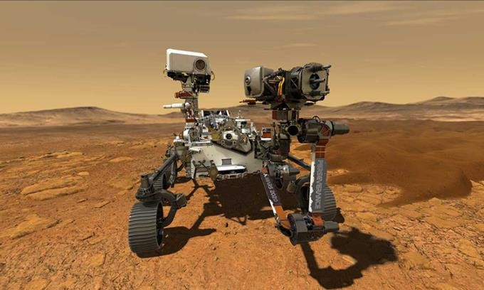

<em>Hình 1.1: Robot Perseverance trên sao Hoả</em>

</blockquote></th>
<th><blockquote>

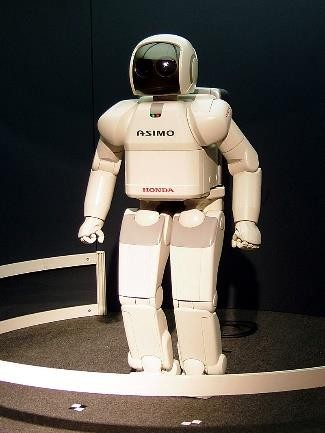

<em>Hình 1.2: Robot hình người ASIMO</em>

</blockquote></th>
</tr>
</thead>
<tbody>
</tbody>
</table>

> Robot di động còn bao gồm các loại phương tiện bay không người lái (Unmanned Aeria Vehices) và phương tiện dưới nước tự trị (Autonomous Underwater Vehices).

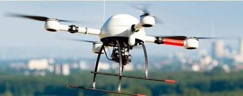

> _Hình 1.3: Robot UAV VA–1000_
>
> Robot di động di chuyển bằng bánh xe được sử dụng rộng rãi vì chúng phù hợp với các ứng dụng đặc trưng, có kết cấu cơ khí đơn giản hơn các loại robot khác và tiêu thụ ít năng lượng hơn. Các loại robot di chuyển bằng chân phù hợp với các địa hình phức tạp, phi tiêu chuẩn. Robot di động còn có thể kể đến các loại tay máy di động (Mobile Manipulator), là robot di động có thể di chuyển bằng bánh xe hoặc chân được trang bị một hoặc nhiều tay máy hạng nhẹ để thực hiện các nhiệm vụ khác nhau.

## Mục tiêu của đề tài

> Mục tiêu của đề tài chính là nghiên cứu và thiết kế Robot phục vụ lễ tân làm việc trong một không gian năng động nhiệt huyết với nhiệm vụ của Robot là vận chuyển các món ăn cùng với thực đơn đến các vị trí bàn khác nhau.
>
> Robot phục vụ lễ tân là một hệ thống cơ điện tử phức tạp, phải có sự phối hợp hài hoà giữa cơ khí, điện và điều khiển. Thêm vào đó, chương trình hoạt động phải chạy đúng yêu cầu các bài toán đặt ra đặt ra của một Robot phục vụ lễ tân:

- Di chuyển và tìm đến vị trí các bàn.

- Hiển thị menu cho khách hàng chọn món.

- Tìm đường về nhà bếp.

- Chở đồ ăn đến những bàn đã chỉ định.

- Giao tiếp một số câu thoại đơn giản

## Phương pháp nghiên cứu

- Phương pháp quan sát thực tế: nhóm chúng em đã có thời gian tiếp cận với các sản phẩm trong thực tế qua quan sát các robot lễ tân trong các khách sạn, nhà hàng...

### + Robot phục vụ Pudu

- Hãng sản xuất: Shenzhen Pudu Technology-hãng công nghệ cung cấp Robot phục vụ đến hàng ngàn chủ nhà hàng Trung Quốc.

- Chức năng: phục vụ được từ 300 đến 400 bữa ăn mỗi ngày.

- Tuổi thọ: 10 năm

- Giá thành: khoảng 5.650 USD đến 7.060 USD

> _Hình 1.4: Robot phục vụ nhà hàng Pudu_

### + Robot CLOi ServeBot

- Hãng sản xuất: LG Electronics – Hàn Quốc.

- Thông số: cao 130 cm, trọng lượng 15kg.

- Chức năng: Serving Robot sẽ xuất hiện ở các khách sạn, phòng chờ sân bay và thậm chí là nhà hàng – nơi nó sẽ bưng bê đồ ăn, đồ uống cho khách hàng nhờ khay đựng của nó.

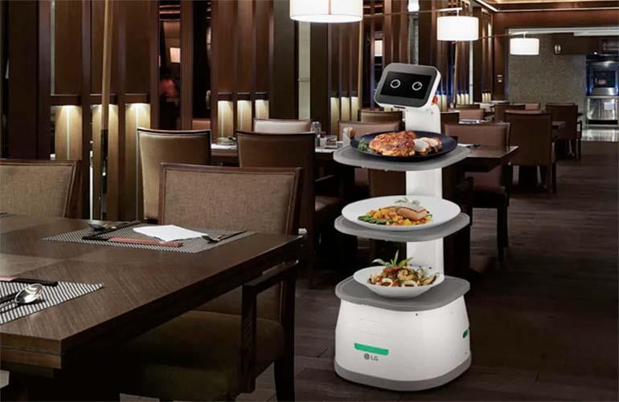

> _Hình 1.5: Robot CLOi ServeBot của hãng LG Electronic_

- Phương pháp nghiên cứu lý thuyết: Trong thời gian nghiên cứu, nhóm đồ án đã tìm hiểu qua các sách tài liệu, các đồ án sinh viên khóa trước, các trang web… liên quan đến đề tài Mobile Robot.

> Từ quá trình bên trên, nhóm đồ án đã quyết định tiến hành xây dựng một robot phục vụ lễ tân bao gồm các kệ để phục vụ trong các quán ăn hay nhà hàng, khách sạn… Để đạt được việc chế tạo ra một con robot tự động phục vụ các yêu cầu trên thì những vấn đề sau cần được tìm hiểu và nghiên cứu:

- Bài toán quét bản đồ tìm đường sử dụng cảm biến Lidar qua bộ điều khiển STM32. Tính toán bài toán động học xác định mối liên hệ giữa các chuyển động và tìm quy luật thay đổi vị trí, quy luật chuyển hướng của robot.

- Tính toán bài toán động lực học tìm hiểu nguyên nhân gây chuyển động và sự liên kết giữa các robot.

- Bài toán điều khiển động cơ giảm tốc và điều khiển tốc độ bằng xung PWM qua giao thức truyền UART.

> Sau khi đã tìm hiểu và nghiên cứu, việc tiến hành làm ra sản phẩm cũng rất quan trọng. Khi sản phẩm được hoàn thành thì sản phẩm phải đạt được những tiêu chí sau:

- Robot tự hành lễ tân phải đi chính xác trên quỹ đạo đã định sẵn từ trước.

- Phát hiện được vật cản bằng cảm biến đồng thời ngừng hoạt động và báo hiệu bằng còi.

- Kích thước nhỏ gọn nhưng vẫn đảm bảo độ cứng vững và tính linh hoạt.

- Vận tốc di chuyển và dừng đỗ chính xác.

- Năng suất làm việc cao, đảm bảo tính ổn định trong quá trình làm việc.

- Khung vỏ dễ dàng tháo lắp, thuận lợi cho việc sửa chữa, nâng cấp.

## Giới hạn, phạm vi nghiên cứu

> Do điều kiện làm việc trong thời gian ngắn và khả năng kiến thức có hạn nên đề tài được giới hạn trong điều kiện sau:

- Nghiên cứu, thiết kế mô hình “Robot phục vụ lễ tân dạng vi sai”.

- Cho phép hoạt động trong phòng thí nghiệm.

- Sử dụng màn hình hiển thị và nút nhấn để tương tác trực tiếp với con người.

- Sử dụng các loại cảm biến khác nhau để tránh va chạm, đảm bảo an toàn cho robot và con người.

# CHƯƠNG 2: CƠ SỞ LÝ THUYẾT

## Nguyên lý làm việc, chức năng của từng module trong hệ thống

1.  **Nguyên lý làm việc**

> Robot lễ tân được xem là một trong những ứng dụng công nghệ khách sạn hiệu quả nhất, robot giúp nâng cao mức độ hài lòng của khách hàng.
>
> Robot là thiết bị hoặc hệ thống được thiết kế để thực hiện một tập hợp các nhiệm vụ cụ thể ở mức độ hiệu quả và độ chính xác gần như tuyệt đối. Ví dụ các robot làm trong dây chuyền lắp ráp và máy CNC, được thiết kế để tạo ra các bộ phận cực kỳ phức tạp mà con người yêu cầu. Ở ngành khách sạn, mục đích chính của robot là nâng cao năng suất lao động và trải nghiệm tổng thể của khách hàng.
>
> Có một vài lý do cho xu hướng này. Ở góc độ tài chính, chi phí triển khai công nghệ khách sạn đã rẻ hơn rất nhiều so với trước kia. Điều này cho thấy rằng bất cứ loại khách sạn nào, thậm chí là rất nhỏ vẫn có thể tận dụng những lợi thế liên quan. Tuy nhiên, chúng ta cũng cần lưu ý các yêu cầu của khách đang bắt đầu thay đổi.
>
> Nhờ kết nối không dây và sự hiện diện gần như khắp nơi của điện thoại thông minh, khách hàng mong đợi chất lượng dịch vụ nhiều hơn trong suốt thời gian lưu trú. Điều này rõ ràng liên quan đến sự hiện diện của công nghệ ở một mức độ nhất định. Robot lễ tân có thể mang lại lợi thế cạnh tranh, vì vậy các nhà quản lý có lý do để tận dụng cơ hội mà robot mang lại.
>
> Như bạn có thể đã tưởng tượng, có rất nhiều loại Robot lễ tân và mỗi loại được thiết kế để phù hợp với một mục đích riêng.
>
> Khi bạn kích hoạt chế độ làm việc cho robot lễ tân, hệ thống quét bản đồ được trang bị cho robot sẽ tiến hành lấy mẫu bản đồ từ môi trường xung quanh. Tiếp theo robot tự động định vị và thiết lập phương án di chuyển và phục vụ cách tối ưu nhất. Một số cảm biến siêu âm được trang bị có thể giúp robot tránh vật cản hoặc dừng tại vị trí mong muốn. Chức năng chạy theo bản đồ giúp cho robot lễ tân có thể lên kế hoạch làm việc nhanh và hiệu quả giúp tiết kiệm thời gian phục vụ.
>
> Màn hình HMI và chức năng phục vụ bằng giọng nói được trang bị thêm khi đến vị trí mong muốn để hiển thị các bàn đã được phục vụ. Quá trình này diễn ra liên tục cho đến khi hoàn thành quá trình phục vụ tại các bàn mong muốn. Khi robot gặp sự cố thì
>
> robot dừng hoạt động kiểm tra vị trí và thông báo cho đến khi được sửa chữa hoặc thiết lập lại từ xa để robot có thể tiếp tục hoạt động.
>
> Hầu như các loại robot lễ tân đều được trang bị nhiều bộ cảm biến thông minh giúp máy có thể tự động dừng lại và tìm kiếm hướng đi khác khi gặp chướng ngại vật, vật cản hoặc cầu thang, hay tìm kiếm và quay trở lại trạm sạc khi gần hết điện.

2.  **Chức năng của từng module trong hệ thống**

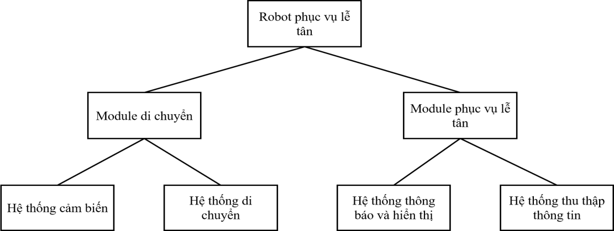

> _Hình 2.1: Sơ đồ cấu trúc hệ thống robot phục vụ lễ tân_
>
> Cấu trúc của một robot phục vụ lễ tân bao gồm hai module chính đó là:

- Module di chuyển: đảm bảo cho việc di chuyển trong không gian nhà hàng, khách sạn. Module di chuyển được chia thành hai hệ thống nhỏ là: Hệ thống cảm biến và hệ thống di chuyển.

> +) Hệ thống cảm biến đảm nhiệm thu thập thông tin vật lý từ môi trường như đường line và vật cảm đảm bảo cho robot đi đúng đường và tránh va chạm không mong muốn.
>
> +) Hệ thống di chuyển có nhiệm vụ đưa đưa robot phục vụ lễ tân đến những nơi đã chỉ định.

- Module phục vụ lễ tân: Đảm bảo cho việc phục vụ trở nên dễ dàng và thuận tiện cho khách hàng. Bên trong module phục vụ lễ tân được chia thành hai hệ thống nhỏ: Hệ thống thông báo và hiển thị, hệ thống thu thập thông tin.

> +) Hệ thống thông báo và hiển thị có chức năng thông báo và hiển thị những thông tin đảm bảo cho chức năng của module lễ tân như: giới thiệu về thực đơn, giới thiệu về nhà hàng, chúc quý khách ngon miệng…
>
> +) Hệ thống thu thập thông tin giúp robot thu thập thông tin từ khách hàng như: thực đơn món ăn, sự hài lòng của khách hàng…
>
> _a, Module di chuyển_
>
> Để có phương án di chuyển phù hợp, nhóm sẽ sử dụng cơ cấu vi sai (Differential drive). Cơ cấu này điều khiển với hai bánh dẫn động phía sau để đạt được vận tốc và góc xoay mong muốn. Xe cần có bánh xe tự lựa để giữ cân bằng.

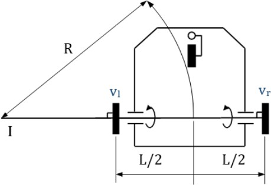

_Hình 2.2: Cơ cấu vi sai_

**+ Ưu điểm**

- Đơn giản về cơ khí và dễ dàng áp dụng.

- Không cần cơ cấu bẻ lái.

- Bán kính quay xe bằng không.

- Điều khiển đồng thời vận tốc và hướng của xe bằng hai động cơ.

> **+ Nhược điểm**

- Khó điều khiển chạy thẳng do hai động cơ độc lập.

- Dễ lật đối với xe chỉ có một bánh tự lựa trên địa hình gồ ghề.

> _b, Module phục vụ lễ tân_
>
> Chức năng chính của module là lên list phục vụ cho khách hàng giúp cho khách hàng được thoải mái.
>
> Các chức năng được xem là một trong những ứng dụng công nghệ khách sạn hiệu quả nhất, robot khách sạn giúp nâng cao mức độ hài lòng của khách hàng. Từ đó tang trải nghiệm của khách hàng và uy tín của nhà hàng hay khách sạn.

### Giới thiệu thực đơn

> Chức năng giới thiệu đa phần quan trọng cho mọi loại hình robot phục vụ nói chúng cũng như robot lễ tân nói riêng. Khi một khách hàng mới đến thì đây là điểm đầu tiên mà khách hàng nhìn vào chưa kể là người đến họ chưa biết gì về nơi mà họ sắp thưởng thức các bữa tiệc.
>
> Robot sẽ chào hỏi khách hàng và trực tiếp giới thiệu thực đơn cho khách hàng thông qua hệ thống loa tích hợp sẵn trên robot sau đó thực hiện công việc thu thập thông tin thực đơn của khách hàng thông qua hệ thống nút nhấn và màn hình hiển thị.

### Lên menu danh sách thực đơn khách yêu cầu

> Khách hàng sẽ lên thực đơn thông qua hệ thống nút ấn và màn hình hiển thị trên robot. Sau khi đã được đặt yêu cầu các món mà khách hàng muốn đặt thì robot có nhiệm vụ ghi lại thông tin yêu cầu từ các vị trí mà khách hàng đặt để tránh sai sót. Vị trí bàn và các món ăn đã đặt sẽ được hiển thị trên màn hình sau khi robot về tới vị trí xuất phát. Thực đơn sau đó sẽ được thông báo cho người quản lý thông quan màn hình hiển thị.

### Hỏi xem khách cần thêm gì cho thực đơn đã chọn hay không?

> Sau khi ghi lại thông tin thì robot có nhiệm vụ hỏi thêm khách hàng cần gì thêm không để cũng như là xác nhận rằng khách hàng đã yêu cầu những thực đơn có trong danh sách. Hoặc là khách hàng có thể quên 1 số món mà đã đặt.
>
> Chức năng này cũng giúp cho chủ khách sạn có thêm được số lượng mà khách hàng yêu cầu, thay vì giới thiệu thực đơn như bình thường thì hỏi người dùng cần thêm đồ gì để có thể cung cấp.

### Giới thiệu về nhà hàng, khách sạn

> Trong quá trình di chuyển trên đường line. Robot sẽ sử dụng loa để phát âm thanh giới thiệu về nhà hàng, khách sạn giúp cho khách hàng hiểu rõ hơn về nhà hàng, khách sạn đó. Đây sẽ là một cách marketing hiệu quả. Ngoài ra, robot sẽ nói them một số câu thoại như “Cảm ơn quý khách đã đến nhà hàng, khách sạn …”, “Chúc quý khách có một ngày tuyệt vời”, “Chúc quý khách ăn ngon miệng”,…để tăng thêm độ thân thiện cho robot.

3.  **Hệ thống điều khiển**

> Hệ thống điều khiển là hệ thống quản lý và ra lệnh, chỉ dẫn các thiết bị hoặc hệ thống khác. Trong dự án này, hệ thống điều khiển có vai trò đặc biệt quan trọng giúp robot phục vụ vừa có thể di chuyển đến những nơi được chỉ định một cách chính xác vừa tạo được các hiệu ứng giao diện người dùng thân thiện.
>
> Để đáp ứng được những yêu cầu của bài toán đặt ra thì hệ thống điều khiển phải sử dụng vi xử lý có công suất mạnh mẽ và có thể hoạt động một cách độc lập. Một số dòng vi điều khiển được đề xuất ở đây là: 8051, PIC, AVR, ARM.
>
> _Bảng 2.1: Bảng phân tích ưu điểm, nhược điểm của các loại vi điều khiển_

<table style="width:97%;">
<colgroup>
<col style="width: 7%" />
<col style="width: 18%" />
<col style="width: 38%" />
<col style="width: 15%" />
<col style="width: 18%" />
</colgroup>
<thead>
<tr>
<th><blockquote>

STT

</blockquote></th>
<th><blockquote>

Loại vi điều khiển

</blockquote></th>
<th><blockquote>

Tổng quan

</blockquote></th>
<th><blockquote>

Ưu điểm

</blockquote></th>
<th><blockquote>

Nhược điểm

</blockquote></th>
</tr>
</thead>
<tbody>
<tr>
<td><blockquote>

1

</blockquote></td>
<td><blockquote>

Vi điều khiển 8051

</blockquote></td>
<td><blockquote>

Vi điều khiển 8051 là dòng vi điều khiển 8-bit được phát triển bởi Intel vào năm 1981. Vi điều khiển này có 128 byte RAM, 4 KB ROM, 2 bộ hẹn giờ, 1 cổng

nối tiếp và 4 cổng trên một chip. CPU cũng có thể hoạt động với 8 bit dữ liệu tại một thời điểm vì 8051 là bộ xử lý 8 bit. Hầu hết vi điều khiển 8051 đều chứa 4 KB ROM, cũng có trường hợp số lượng ROM có thể vượt quá lên đến 64 KB.

</blockquote></td>
<td><ul>
<li>
Giá thành rẻ.
</li>
<li>
Dễ dàng lập trình.
</li>
</ul></td>
<td><ul>
<li>
Không ổn định
</li>
<li>
Không tích hợp sẵn board mạch điều khiển.

<ul>
<li>
Số lượng chân vi điều khiển còn hạn chế.
</li>
<li>
Khó làm mạch điều khiển.
</li>
</ul></li>
</ul></td>
</tr>
<tr>
<td><blockquote>

2

</blockquote></td>
<td><blockquote>

Vi điều khiển PIC của Microchip

</blockquote></td>
<td><blockquote>

- Bộ điều khiển giao diện ngoại vi (PIC) là vi điều khiển được phát triển bởi Microchip,

vi điều khiển PIC thực hiện chương trình nhanh chóng và

</blockquote></td>
<td><ul>
<li>
Dễ dàng lập trình.
</li>
<li>
Giá thành rẻ.
</li>
</ul></td>
<td><ul>
<li>
Hơi khó cho người mới bắt đầu tìm hiểu.
</li>
<li>
Khó thiết kế mạch.
</li>
</ul></td>
</tr>
</tbody>
</table>

<table style="width:97%;">
<colgroup>
<col style="width: 7%" />
<col style="width: 18%" />
<col style="width: 38%" />
<col style="width: 15%" />
<col style="width: 18%" />
</colgroup>
<thead>
<tr>
<th></th>
<th></th>
<th><blockquote>

đơn giản khi so sánh với các vi điều khiển khác như 8051.

- Chúng ta biết rằng vi điều khiển là một chip tích hợp bao

gồm RAM, ROM, CPU, TIMER và COUNTER. PIC là

vi điều khiển cũng bao gồm RAM ROM, CPU, TIMER,

COUNTER, ADC (bộ chuyển đổi analog sang kỹ thuật số), DAC (bộ chuyển đổi kỹ thuật số sang analog). Vi điều khiển PIC cũng hỗ trợ các giao thức như CAN, SPI, UART để giao tiếp với các thiết bị ngoại vi bổ sung.

</blockquote></th>
<th></th>
<th style="text-align: center;"><blockquote>

- Số lượng chân vi điều khiển còn hạn chế.

</blockquote></th>
</tr>
</thead>
<tbody>
<tr>
<td><blockquote>

3

</blockquote></td>
<td><blockquote>

Vi điều khiển ATMega2560

</blockquote></td>
<td><blockquote>

ATMega2560 của hãng Atmel là vi điều khiển công

suất thấp 8 bit là board mạch Arduino Mega phổ biến. Có kiến trúc vi mạch AVR RISC 8 bit với bộ nhớ flash 256KB, 8KB SRAM và EEPROM 4KB. Hỗ trợ nhiều loại thiết bị ngoại vi, bao gồm bộ định thời, bộ đếm, bộ tạo

PWM, bộ so sánh và ADC. Có thể đạt tốc độ xử lý lên đến 16MHz với nguồn cấp 5V.

</blockquote></td>
<td><ul>
<li>
Dễ dàng lập trình và điều khiển.

<ul>
<li>
Cộng đồng sử dụng đông đảo.
</li>
</ul></li>
<li>
Thư viện hỗ trợ đa dạng.

<ul>
<li>
Phần mềm lập trình dễ tiếp cận và
</li>
</ul></li>
</ul></td>
<td><blockquote>

- Chỉ thực hiện được các project đơn giản

</blockquote></td>
</tr>
</tbody>
</table>

<table style="width:97%;">
<colgroup>
<col style="width: 7%" />
<col style="width: 18%" />
<col style="width: 38%" />
<col style="width: 15%" />
<col style="width: 18%" />
</colgroup>
<thead>
<tr>
<th></th>
<th></th>
<th></th>
<th style="text-align: center;"><blockquote>

dễ dàng nạp chương trình (phù hợp với người mới).

</blockquote>
<ul>
<li>
Có nhiều board mạch thiết kế sẵn.
</li>
<li>
Phù hợp với các chương trình phức tạp.
</li>
</ul></th>
<th></th>
</tr>
</thead>
<tbody>
<tr>
<td><blockquote>

4

</blockquote></td>
<td><blockquote>

Bộ xử lý ARM

</blockquote></td>
<td><blockquote>

- ARM tạo ra bộ vi xử lý đa lõi RISC 32 bit và 64 bit.

- Bộ xử lý ARM được sử dụng rộng rãi trong các thiết bị điện tử như điện thoại thông minh, máy tính bảng, trình phát đa phương tiện và các thiết bị di động khác, chẳng hạn như

thiết bị đeo. Do được giảm thành tập lệnh, nên nó cần ít transistor hơn, cho phép kích thước khuôn IC nhỏ hơn. Vi xử lý ARM kích thước nhỏ, giảm độ khó và tiêu thụ điện năng

</blockquote></td>
<td style="text-align: center;"><blockquote>

- Kích thước nhỏ gọn nhưng mạnh mẽ.

</blockquote>
<ul>
<li>
Giá thành phù hợp với hiệu năng.
</li>
<li>
Phù hợp với những chương trình hiệu suất cao.
</li>
</ul></td>
<td><blockquote>

- Khó cho người mới bắt đầu.

</blockquote></td>
</tr>
</tbody>
</table>

<table style="width:97%;">
<colgroup>
<col style="width: 7%" />
<col style="width: 18%" />
<col style="width: 38%" />
<col style="width: 15%" />
<col style="width: 18%" />
</colgroup>
<thead>
<tr>
<th></th>
<th></th>
<th><blockquote>

thấp nên rất phù hợp với các thiết bị thu nhỏ.

</blockquote></th>
<th></th>
<th></th>
</tr>
</thead>
<tbody>
</tbody>
</table>

> 🡪 Sau những ưu điểm và nhược điểm được phân tích ở trên, nhóm quyết định sử vi điều khiển dòng ARM bởi sự mạnh mẽ mà nó đem lại.

1.  **Hệ thống cảm biến**

> Đối với mô hình robot di động phục vụ lễ tân, cảm biến đóng vai trò cực kì quan trọng giúp cho robot có thể cảm nhận những tác nhân vật lý tác động lên robot trong quá trình hoạt động. Từ các số liệu hệ thống cảm biến robot có thể đo đạc, tính toán và đưa ra các quyết định của robot.
>
> Robot di chuyển luôn được trang bị các cảm biến phát hiện vật cản với mục đích chính để đảm bảo an toàn cho người và vật xung quanh khu vực di chuyển của robot. Mỗi vị trí lắp cảm biến trên xe có chức năng riêng. Ví dụ như:

- Tự động tính toán và duy trì tốc độ trong khu vực an toàn.

- Tự động phanh khẩn cấp khi nhận ra vật cản ở quá gần.

- Cảnh báo khi phát hiện vật cản hoặc người di chuyển ở trong vùng di chuyển của robot.

> _Bảng 2.2: Bảng phân tích ưu, nhược điểm của các loại cảm biến phát hiện vật cản_

<table style="width:97%;">
<colgroup>
<col style="width: 7%" />
<col style="width: 13%" />
<col style="width: 39%" />
<col style="width: 16%" />
<col style="width: 20%" />
</colgroup>
<thead>
<tr>
<th><blockquote>

STT

</blockquote></th>
<th><blockquote>

Tên cảm biến

</blockquote></th>
<th><blockquote>

Tổng quan

</blockquote></th>
<th><blockquote>

Ưu điểm

</blockquote></th>
<th><blockquote>

Nhược điểm

</blockquote></th>
</tr>
</thead>
<tbody>
<tr>
<td><blockquote>

1

</blockquote></td>
<td><blockquote>

Cảm biến Radar

</blockquote></td>
<td><blockquote>

- Cảm biến Radar là cảm biến vi sóng, hoạt động dựa trên hiệu ứng doppler, tần số 5.8 Ghz dưới

10m. Mọi loại Radar đều hoạt động bằng cách phát ra sóng rồi nhận tín hiệu phản xạ. Sau đó chuyển tín hiệu đó thành thông tin để đưa vào bộ xử lý trung tâm.

</blockquote></td>
<td><ul>
<li>
Vùng cảm biến rộng (tốt nhất trong bán kính 6-8m).
</li>
<li>
Góc quét rộng.
</li>
<li>
Phù hợp với xe tự
</li>
</ul>
<blockquote>

hành có vận

</blockquote></td>
<td><blockquote>

- Góc nhìn hẹp, không thể sử dụng cho góc nhìn 360 độ.

- Không nhận dạng được ký tự quang học: màu sắc, độ tương phản.

</blockquote></td>
</tr>
</tbody>
</table>

<table style="width:97%;">
<colgroup>
<col style="width: 7%" />
<col style="width: 13%" />
<col style="width: 39%" />
<col style="width: 16%" />
<col style="width: 20%" />
</colgroup>
<thead>
<tr>
<th></th>
<th></th>
<th><ul>
<li>
Nguyên lý hoạt động: Sử dụng cụm sóng âm thanh để đo
</li>
</ul>
<blockquote>

khoảng cách.

</blockquote>
<ul>
<li>
Cảm biến Radar trên xe tự hành sử dụng loại Radar tầm
</li>
</ul>
<blockquote>

gần. Nó có thể thay thế cảm biến siêu âm, cảnh báo vật cản, hỗ trợ dừng xe khi vật cản ở quá gần.

</blockquote></th>
<th style="text-align: center;"><blockquote>

tốc tương đối.

- Dữ liệu xử lý vừa phải.

</blockquote></th>
<th style="text-align: left;"><blockquote>

- Giá thành khá cao so với cảm biến siêu âm.

</blockquote></th>
</tr>
</thead>
<tbody>
<tr>
<td><blockquote>

2

</blockquote></td>
<td><blockquote>

Cảm biến siêu âm – Ultrasonic range sensor

</blockquote></td>
<td><blockquote>

- Nguyên lý hoạt động: Sử dụng sóng âm thanh tần số cao

để đo (40 -70 kHz)

</blockquote>
<ul>
<li>
Tín hiệu được bức xạ tới mục tiêu và phản xạ lại nguồn.
</li>
<li>
Chính vì chi phí thấp nên cảm biến siêu âm được sử dụng nhiều
</li>
</ul>
<blockquote>

với tính linh hoạt cao

- Ultrasonic chính là loại cảm biến thích hợp để xử lý các va chạm này. Chúng giúp xe tự hành AGV trở nên thông minh và thực hiện tốt công việc vận

chuyển nguyên vật liệu.

</blockquote></td>
<td><ul>
<li>
Thời gian phản hồi nhanh, độ chính xác tốt trong phạm vi ngắn, sai số khoảng 0,15% (2m)

<ul>
<li>
Chi phí thấp
</li>
<li>
Thường được lắp đặt tại điểm mù trên xe
</li>
</ul></li>
</ul></td>
<td style="text-align: center;"><blockquote>

- Cự li hoạt động ngắn

- Không nhận dạng ký tự quang học

- Cảm biến siêu âm sử dụng cho xe tự hành chịu ảnh hưởng nhiều bởi nhiệt độ và áp suất.

Vì thế nên AGV chỉ phù hợp hoạt động trong môi trường nhiệt độ nhỏ hơn 60 độ C và áp suất nhỏ hơn 1 bar.

- Dễ bị nhiễu tín hiệu khi lắp đặt, vì thế nên

</blockquote></td>
</tr>
</tbody>
</table>

<table style="width:97%;">
<colgroup>
<col style="width: 7%" />
<col style="width: 13%" />
<col style="width: 39%" />
<col style="width: 16%" />
<col style="width: 20%" />
</colgroup>
<thead>
<tr>
<th></th>
<th></th>
<th></th>
<th style="text-align: center;"></th>
<th style="text-align: center;"><blockquote>

cần chú ý lắp đặt đúng hướng dẫn.

</blockquote></th>
</tr>
</thead>
<tbody>
<tr>
<td><blockquote>

3

</blockquote></td>
<td><blockquote>

Cảm biến LiDAR

</blockquote></td>
<td><blockquote>

- Nguyên lý hoạt động: Sử dụng laser để đo khoảng cách vật cản, từ đó tiến hành thao tác

phù hợp.

</blockquote>
<ul>
<li>
LiDAR hoạt động bằng cách phát ra tia laser rồi đo tín hiệu phản xạ trở lại với độ chính xác rất cao. LIDAR thường được ứng dụng để quét địa hình thành bản đồ 3D. Thậm chí với sự phát
</li>
</ul>
<blockquote>

triển công nghệ như hiện nay, LIDAR có thể giúp cho việc phanh khẩn cấp hiệu quả, chính xác hơn và tránh va chạm.

</blockquote>
<ul>
<li>
Chính vì sự chính xác của nó nên chi phí cho loại cảm biến này khá cao. Nên cân nhắc lại chi phí cho xe tự hành AGV khi
</li>
</ul>
<blockquote>

lựa chọn loại cảm biến này.

</blockquote></td>
<td style="text-align: center;"><blockquote>

- Đo khoảng cách với độ chính xác cao, khoảng đo khá rộng (lên tới 200m).

</blockquote>
<ul>
<li>
Hình ảnh có độ phân giải lớn, có khả năng quét 3D theo tỉ lệ thời gian, đưa ra phân tích chính xác về môi trường xung quanh.
</li>
<li>
Hoạt động tốt ngay cả trong điều kiện ánh sáng yếu.
</li>
</ul></td>
<td><ul>
<li>
Không hoạt động hiệu quả bằng Radar.
</li>
<li>
Không nhận dạng ký tự quang học.
</li>
<li>
Dữ xử lý liệu lớn.
</li>
</ul></td>
</tr>
</tbody>
</table>

<table style="width:97%;">
<colgroup>
<col style="width: 7%" />
<col style="width: 13%" />
<col style="width: 39%" />
<col style="width: 16%" />
<col style="width: 20%" />
</colgroup>
<thead>
<tr>
<th><blockquote>

4

</blockquote></th>
<th><blockquote>

Vision camera – Optic sensor

</blockquote></th>
<th><blockquote>

- Xe tự hành AGV cần tích hợp Vision camera để dẫn đường cho

AGV di chuyển. Nó thường được kết hợp với LiDAR để cung cấp khả năng điều hướng cho robot AGV.

- Nguyên lý hoạt động: Sử dụng thị giác máy tính vision camera để nhận dạng và đo

lường đối tượng.

- Bộ điều khiển của AGV sẽ nhận thông tin truyền về từ thị giác máy dưới dạng điện áp hoặc trên giao diện kỹ thuật số. Với cảm biến vạch quang, AGV có

thể phát hiện băng dính phát quang thông thường dù nó có bị bẩn hay mờ.

</blockquote></th>
<th><ul>
<li>
Cảm biến nhanh nhạy, trả về kết quả chính xác cao.
</li>
<li>
Chi phí rất vừa phải.
</li>
</ul></th>
<th style="text-align: center;"><blockquote>

- FOV giới hạn, góc quét hẹp, không quét được góc 360 độ

- Không hoạt động tốt trong điều kiện ánh sáng yếu hoặc điều kiện ánh sáng khác nhau

- Tiêu thụ nhiều năng lượng xử lý vì cần xử lý lượng dữ liệu lớn.

</blockquote></th>
</tr>
</thead>
<tbody>
</tbody>
</table>

> Từ những ưu điểm và nhược điểm kể trên. Nhóm chúng tôi quyết định lựa chọn cảm biến LiDAR cho dự án của mình vì cảm biến LiDAR vừa đảm bảo chất lượng hình ảnh của bản đồ, thời gian phản hồi nhanh, chính xác lại đảm bảo về yêu cầu về tốc độ xử lý của vi xử lý đã lựa chọn.

1.  **Cơ cấu chấp hành**

> Cơ cấu chấp hành của robot di động phục vụ lễ tân nằm toàn bộ ở bộ phận di chuyển của robot.
>
> Robot tự hành di động nên thông thường sử dụng động cơ dùng dòng điện DC. Một số loại động cơ dùng dòng điện DC như: động cơ bước, động cơ DC, động cơ DC servo. Robot tự hành cần điều khiển vận tốc nên động cơ DC phải có hồi tiếp vận tốc (mặc dù một số động cơ DC điều khiển được chính xác vận tốc, không cần hồi tiếp nhưng giá sẽ rất cao). Do đó chọn động cơ bước hoặc động cơ DC servo là phương án khả thi. Sau
>
> đây là những phân tích về ưu, nhược điểm của hai loại động cơ này, từ đó có thể xác định được loại động cơ cần dùng để phù hợp với yêu cầu đặt ra.
>
> _a, Động cơ bước_
>
> Động cơ bước thông thường là loại động cơ điều khiển vòng hở, biến đổi các xung điện rời rạc kế tiếp nhau thành chuyển động quay của rotor. Giá trị góc quay phụ thuộc và số xung điện cấp vào động cơ. Mỗi vòng quay có số bước cố định, thay đổi tốc độ quay bằng cách thay đổi tốc độ tín hiệu điện cấp cho động cơ.

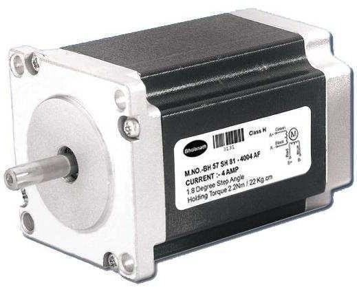

_Hình 2.3: Động cơ bước_

**Ưu điểm:**

- Không cần hồi tiếp tín hiệu.

- Điều khiển chính xác, không có vọt lố và có momen giữ tại một vị trí.

**Nhược điểm:**

- Dễ bị trượt bước khi mang tải lớn.

- Tốc độ của động cơ không cao, tối đa từ 1000 ÷ 2000 (rpm).

- Gây rung động.

_b, Động cơ DC servo_

> Động cơ DC servo là động cơ DC có thêm bộ phận đo thông số đầu ra của động cơ thông thường là góc quay, vận tốc quay. Từ các sai số góc quay, vận tốc quay thì bộ điều khiển sẽ tăng hay giảm dòng cấp cho động cơ để đạt góc quay, vận tốc mong muốn.
>
> 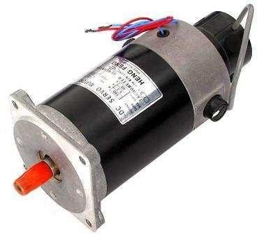
>
> _Hình 2.4: Động cơ DC servo_
>
> **Ưu điểm:**

- Momen khởi động và vận tốc lớn.

- Động cơ chạy êm khi đạt vận tốc cố định.

- Có tín hiệu hồi tiếp nên có thể điều khiển được góc quay và vận tốc.

> **Nhược điểm:**

- Khi dừng lại, tùy theo chất lượng của bộ điều khiển ảnh hưởng đến đáp ứng nên có thể gây dao động, rung lắc.

- Tín hiệu hồi tiếp có thể bị nhiễu.

- Dưới đây là bảng tổng kết các đặc điểm của hai loại động cơ đã được phân tích.

> Dựa vào phân tích và điều kiện hoạt động của robot, động cơ DC servo sẽ là phương án được lựa chọn để thiết kế robot.
>
> Từ những so sánh trên, lựa chọn phương án sử dụng động cơ DC servo và bộ truyền bánh răng. Kết hợp với những yêu cầu thiết kế robot như linh hoạt, nhỏ gọn nên chọn loại động cơ DC servo có tích hợp sẵn hộp giảm tốc.

## Hệ điều hành Ubuntu và mô phỏng mobile robot trên Gazebo

1.  **Hệ điều hành Ubuntu**

_a, Tổng quan hệ điều hành Ubuntu_

> Ubuntu là một hệ điều hành máy tính dựa trên Debian GNU/Linux, một bản phân phối Linux thông dụng. Ubuntu là hệ điều hành mã nguồn mở tự do, có nghĩa là người dùng được tự do chạy, sao chép, phân phối, nghiên cứu, thay đổi và cải tiến phần mềm theo điều khoản của giấy phép GNU GPL.

> _Hình 2.5: Giao diện hệ điều hành Ubuntu_

- **Ưu điểm của hệ điều hành Ubuntu:**
  - Ubuntu hoàn toàn miễn phí

  - Hệ điều hành Ubuntu hoàn toàn không có virus

  - Mọi phần mềm được auto update 100%

  - Ubuntu luôn bảo vệ mọi dữ liệu quý giá của người sử dụng

  - Ít tốn tài nguyên phần cứng

  - Khả năng tương thích cao

  - Kho ứng dụng là hoàn toàn miễn phí và môi trường khổng lồ

  - Chạy được nhiều ứng dụng có ở hệ điều hành Window.

> Phiên bản Ubuntu nhóm chúng em lựa chọn là phiên bản Ubuntu 20.04 LTS, bởi:

- Hiệu suất desktop được cải thiện với mức sử dụng CPU thấp

- Người dùng có tốc độ khung hình cao và mượt mà hơn

- Người dùng có thể cài đặt trực tiếp từ trình cài đặt

- Phiên bản Ubuntu 20.04 LTS tăng tốc độ khoa học dữ liệu, trên laptop và workstation bằng cách cung cấp các công cụ, trình điều khiển và thư viện mới nhất.

> _b, Mô phỏng Mobile robot trên Gazebo_
>
> Gazebo mô phỏng một hay nhiều robot trong một không gian mở. Có khả năng mô phỏng một loại robot, cảm biến và vật thể trong thế giới 3 chiều. Tạo ra phản hồi cho các cảm biến khi tương tác với các đối tượng trên bản đồ kỹ thuật số.
>
> Đặc tính kỹ thuật của Gazebo:

- Mô phỏng động.

- Đồ họa 3D nâng cao.

- Cảm biến và tiếng ồn.

- Không giản mở, có thể tự bổ sung, tùy chỉnh robot, cảm biến và môi trường điều khiển nhờ API của nó.

- Có nhiều mô hình robot.

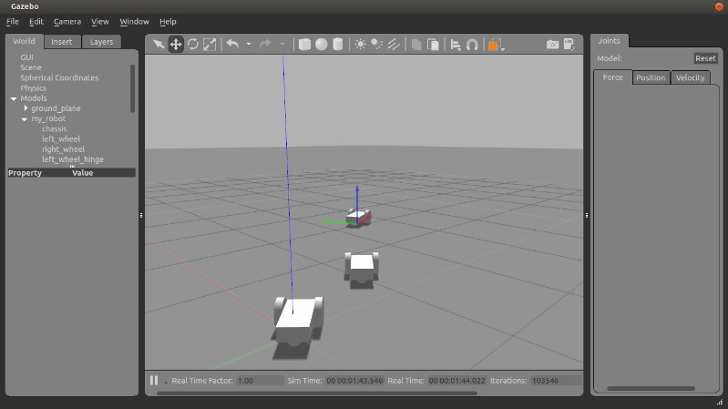

> _Hình 2.6: Mô phỏng Mobile robot trên Gazebo_

## Phương pháp quét bản đồ bằng Lidar trên Gazebo

> ROS có một loại thông báo cụ thể cho dữ liệu quét laser 2D, được gọi là **sensor_msgs/LaserScan**. Mỗi **LaserScan** thông báo chứa dữ liệu cho một lần quét cảm biến và về cơ bản là một mảng các dấu nổi đại diện cho mỗi phép đo phạm vi (tính bằng mét), cùng với một số thông số bổ sung để hỗ trợ hiểu dữ liệu đúng cách. Thông báo LaserScan này cũng cho chúng ta biết khung TF nào được gắn vào lidar, để phần còn lại của hệ thống có thể tìm ra vị trí các điểm đánh trong không gian 3D. Điều này đặc biệt hữu ích cho những việc như kết hợp quét từ nhiều cảm biến cùng một lúc.

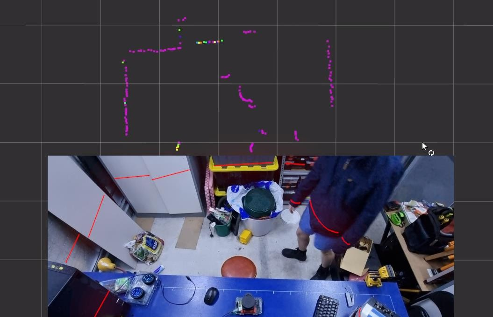

_Hình 2.7: Quét bản đồ từ LiDAR 2D_

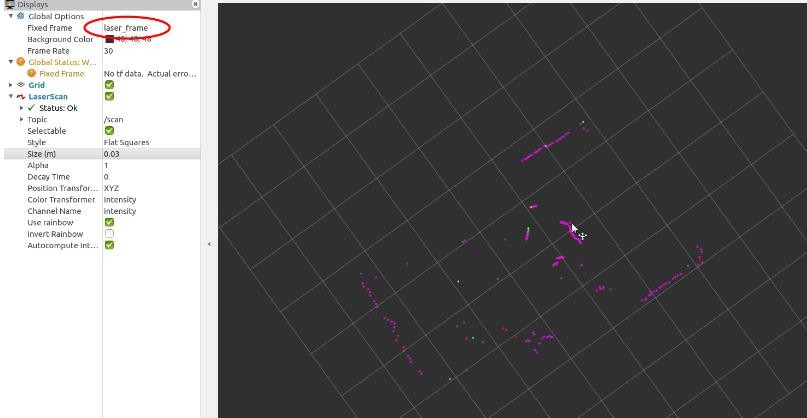

_Hình 2.8: Mô phỏng quét LiDAR trên Rviz_

## Tổng quan về ROS.

> Robot operating system (ROS) là một hệ thống phần mềm có tính linh hoạt và chuyên dụng cao dùng để lập trình và điều khiển robot. ROS bao gồm các thư viện, công cụ hỗ trợ lập trình, công cụ đồ họa, các công cụ hỗ trợ giao tiếp điều khiển trực tiếp với phần cứng cũng như các thư viện hỗ trợ việc lấy dữ liệu từ các cảm biến và các thuật toán phổ biến trong lập trình điều khiển robot.
>
> ROS giúp người dùng có thể dễ dàng kết nối các máy tính ở trên robot (Raspberry pi, Jetson Nano, các loại máy tính nhúng, mini computer, …) với laptop để điều khiển hoặc thao tác từ xa

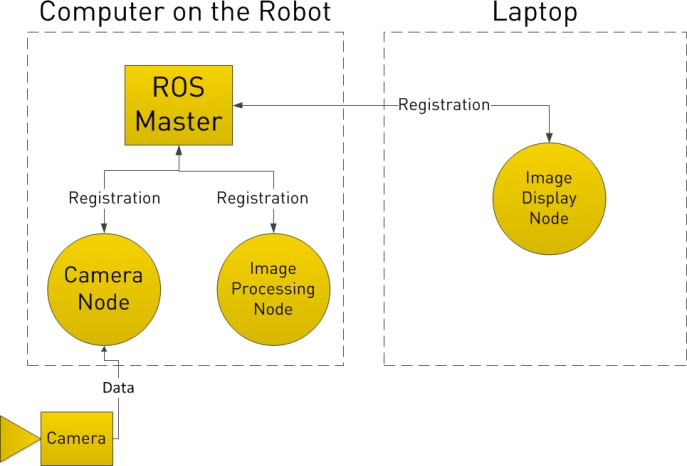

> _Hình 2.9: ROS kết nối_
>
> Camera sẽ thu thập dữ liệu từ môi trường, thông qua Camera Node gửi tới Master, master sẽ chứa toàn bộ thông tin của hệ thống và giao tiếp với các node khác.
>
> ROS giúp đơn giản và tiết kiệm thời gian việc lập trình các hành vi phức tạp của robot. ROS như là một mạng lưới điểm (node) được kết nối bởi nhiều node mà mỗi node có nhiệm vụ riêng tương ứng với các thành phần cấu tạo nên robot. Mỗi node riêng có thể được tùy chỉnh phát triển và lập trình theo ý tưởng
>
> của người phát triển mà không cần quan tâm đến việc phải thống nhất sử dụng cùng một ngôn ngữ lập trình, điều đó có nghĩa là node này bạn phát triển trên ngôn ngữ C++ nhưng node khác bạn có thể phát triển trên ngôn ngữ Python. Python và C++ là hai ngôn ngữ nền tảng mà bạn cần phải học trước khi làm quen với ROS.
>
> ROS chạy trên nền Ubuntu, do đó bạn phải cài ROS trên nền Ubuntu. Hiện tại có hai phiên bản phổ biến là ROS Melodic và ROS Kinetic, phiên bản Melodic tương thích và chạy trên Ubuntu 18 trong khi đó Kinetic chạy trên nền Ubuntu 16. Ngoài ra còn có ROS Noetic cho bản Ubuntu 20. Các bạn có thể dễ dàng cài đặt ROS theo hướng dẫn trên trang chủ của ROS.
>
> ROS bao gồm các cấu thành bởi các thành phần như hình sau:

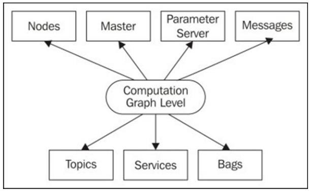

> _Hình 2.10: Thành phần của ROS_

- **Nodes**: là đơn vị cơ bản nhằm hỗ trợ giao tiếp với các thành phần cấu thành nên robot. Vì dụ như một con robot thường có các node như Laser scanner, Camera, Node gửi vận tốc đến thiết bị điều khiển động cơ. Các nodes này có thể giao tiếp và tương tác với nhau qua Master.

- **Master**: đóng vai trò kết nối các node với nhau. Do đó, master luôn được khởi động đầu tiên bằng cầu lệnh roscore sau đó thì bạn có thể gọi bất kỳ các node nào trong hệ thống. Sau khi gọi xong, các node có thể kết nối và tương tác với nhau.

- **Parameter Server**: Là một cấu trúc nhiều tham số có thể truy cập trong lúc chạy ROS. Các node sử dụng cấu trúc này nhằm lưu trữ và truy xuất các thông số trong thời gian chạy. Do nó không có hiệu suất cao nên thường dùng với kiểu dữ liệu tĩnh, chẳng hạn như các thông số cấu hình, thời gian hệ thống.

- **Message**: Đây là cấu trúc dữ liệu được các node sử dụng để trao đổi với nhau tương tự như các kiểu dữ liệu double, int trong các ngôn ngữ lập trình. Các node tương tác với nhau bằng cách send và receive ROS message.

- **Topics**: là phương pháp giao tiếp trao đổi dữ liệu giữa hai node, nó bao gồm nhiều cấp bậc thông tin mà chúng có thể giao tiếp thông qua ROS message. Hai phương thức trong topic bao gồm publish và subscribe.

<!-- -->

- publish là đăng kí gửi thông tin

- subscribe là đăng ký nhận thông tin

<!-- -->

- **Services**: Là một giao tiếp trao đổi dữ liệu/ thông tin giữa hai node thông qua phương thức request và response. Thường được áp dụng trong trường hợp việc thực hiện một lệnh cần nhiều thời gian xử lý nên dữ liệu tính toán được lưu ở server và sẽ dùng khi cần xử lý.

- **Bags**: là một định dạng tệp trong ROS dùng để lưu trữ dữ liệu message với phần mở rộng là _.bag_ có vai trò quan trọng và có thể được xử lý, ph

> ROS phát triển nhiều packages và meta packages ứng dụng cho xe tự hành, chẳng hạn như Navigation stack, ROS Gmapping, Ros_Industrial và perception_pcl…

- Navigation stack: mục đích chính của Navigation package là để di chuyển robot từ vị trí bắt đầu đến một vị trí đích mong muốn mà không gặp bất kỳ sự cản trở nào từ môi trường. ROS Navigation package đem đến sự bổ xung của nhiều thuật toán định vị liên quan giúp dễ dàng thực hiện định vị trong robot di động.

- ROS Gmapping: ROS Gmapping package chứa một node là slam_gmapping, giúp tạo ra lưới bản đồ 2D từ cảm biến laser và vị trí của robot.

- ROS-Industrial: cơ bản mở rộng các tính năng của ROS tới ngành công nghiệp robot, cái mà đang làm việc trong quá trình tạo ra sản phẩm. ROSIndustrial bao gồm nhiều gói phần mềm sử dụng để tương tác với robot công nghiệp.

- Perception_pcl: là một giao diện ROS cho thự viện PCL ( Point Cloud Library). Nó chứa các gói cho việc bơm dữ liệu điểm đám mây từ nhiều cảm biến khác nhau.

## Xây dựng mô hình hệ thống

1.  **Mô hình động học**

> Mô hình thiết kế robot lễ tân được mô tả như hình sau:

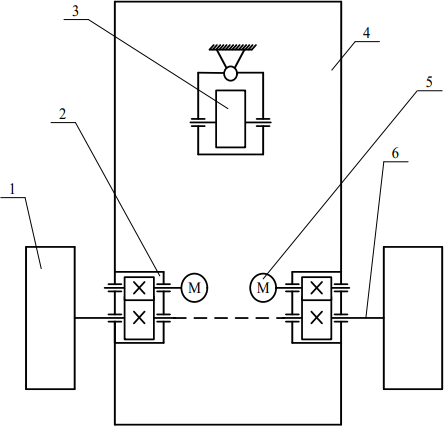

> _Hình 2.11: Mô hình robot_
>
> Trong đó:

<table style="width:65%;">
<colgroup>
<col style="width: 40%" />
<col style="width: 24%" />
</colgroup>
<thead>
<tr>
<th><blockquote>

1. Bánh xe dẫn động

</blockquote></th>
<th style="text-align: right;">4. Khung robot</th>
</tr>
</thead>
<tbody>
<tr>
<td><blockquote>

2. Cơ cấu truyền chuyển động

</blockquote></td>
<td style="text-align: right;">5. Động cơ DC</td>
</tr>
</tbody>
</table>

<table style="width:67%;">
<colgroup>
<col style="width: 32%" />
<col style="width: 34%" />
</colgroup>
<thead>
<tr>
<th><blockquote>

3. Bánh xe phụ

</blockquote></th>
<th><blockquote>

6. Trục dẫn động

</blockquote></th>
</tr>
</thead>
<tbody>
</tbody>
</table>

> _a, Phương trình động học thuận_
>
> Phương trình động học được thiết lập dựa trên mô hình robot di động hệ vi sai với tốc độ bánh trái và tốc độ bánh phải lần lượt là 𝑉𝑙 và 𝑉𝑟

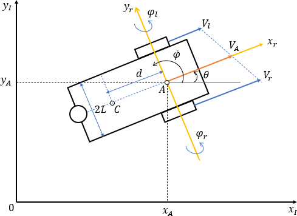

> _Hình 2.12: Mô hình robot và các thông số động học_
>
> Trong đó:

<table style="width:98%;">
<colgroup>
<col style="width: 32%" />
<col style="width: 11%" />
<col style="width: 54%" />
</colgroup>
<thead>
<tr>
<th style="text-align: center;"><blockquote>

<strong>Kí hiệu</strong>

</blockquote></th>
<th style="text-align: center;"><blockquote>

<strong>Đơn vị</strong>

</blockquote></th>
<th style="text-align: center;"><blockquote>

<strong>Ý nghĩa</strong>

</blockquote></th>
</tr>
</thead>
<tbody>
<tr>
<td style="text-align: center;"><blockquote>

R

</blockquote></td>
<td style="text-align: center;"><blockquote>

m

</blockquote></td>
<td style="text-align: center;"><blockquote>

Bán kính bánh xe.

</blockquote></td>
</tr>
<tr>
<td style="text-align: center;"><blockquote>

r

</blockquote></td>
<td style="text-align: center;"><blockquote>

m

</blockquote></td>
<td style="text-align: center;"><blockquote>

Bán kính đường cong tạo bởi tốc độ quay của robot (tính đến tâm A).

</blockquote></td>
</tr>
<tr>
<td style="text-align: center;"><blockquote>

2L

</blockquote></td>
<td style="text-align: center;"><blockquote>

m

</blockquote></td>
<td style="text-align: center;"><blockquote>

Khoảng cách 2 bánh dẫn.

</blockquote></td>
</tr>
</tbody>
</table>

<table style="width:98%;">
<colgroup>
<col style="width: 32%" />
<col style="width: 11%" />
<col style="width: 54%" />
</colgroup>
<thead>
<tr>
<th style="text-align: center;"><blockquote>

𝜑𝑟, 𝜑𝑙

</blockquote></th>
<th style="text-align: center;"><blockquote>

rad

</blockquote></th>
<th style="text-align: center;"><blockquote>

Góc quay bánh xe phải, trái quay quanh trục.

</blockquote></th>
</tr>
</thead>
<tbody>
<tr>
<td style="text-align: center;"><blockquote>

𝜃

</blockquote></td>
<td style="text-align: center;"><blockquote>

rad

</blockquote></td>
<td style="text-align: center;"><blockquote>

Góc nghiêng của thân robot.

</blockquote></td>
</tr>
<tr>
<td style="text-align: center;"><blockquote>

𝜑̇𝑟, 𝜑̇𝑙

</blockquote></td>
<td style="text-align: center;"><blockquote>

rad/s

</blockquote></td>
<td style="text-align: center;"><blockquote>

Vận tốc quay bánh phải, trái.

</blockquote></td>
</tr>
<tr>
<td style="text-align: center;"><blockquote>

𝜃̇ = 𝜔

</blockquote></td>
<td style="text-align: center;"><blockquote>

rad/s

</blockquote></td>
<td style="text-align: center;"><blockquote>

Vận tốc quay của robot.

</blockquote></td>
</tr>
<tr>
<td style="text-align: center;"><blockquote>

𝑉𝑎

</blockquote></td>
<td style="text-align: center;"><blockquote>

m/s

</blockquote></td>
<td style="text-align: center;"><blockquote>

Vận tốc dài của robot.

</blockquote></td>
</tr>
<tr>
<td style="text-align: center;"><blockquote>

r + L

</blockquote></td>
<td style="text-align: center;"><blockquote>

m

</blockquote></td>
<td style="text-align: center;"><blockquote>

Bán kính đường cong tính đến bánh phải.

</blockquote></td>
</tr>
<tr>
<td style="text-align: center;"><blockquote>

r - L

</blockquote></td>
<td style="text-align: center;"><blockquote>

m

</blockquote></td>
<td style="text-align: center;"><blockquote>

Bán kính đường cong tính đến bánh trái.

</blockquote></td>
</tr>
<tr>
<td style="text-align: center;"><blockquote>

mc = M

</blockquote></td>
<td style="text-align: center;"><blockquote>

kg

</blockquote></td>
<td style="text-align: center;"><blockquote>

Khối lượng thân robot.

</blockquote></td>
</tr>
<tr>
<td style="text-align: center;"><blockquote>

mw

</blockquote></td>
<td style="text-align: center;"><blockquote>

kg

</blockquote></td>
<td style="text-align: center;"><blockquote>

Khối lượng bánh xe + động cơ.

</blockquote></td>
</tr>
<tr>
<td style="text-align: center;"><blockquote>

1

𝐼𝑐 = 𝐽 = 𝑚𝑐(𝑎2 + 𝑏2)

12

</blockquote></td>
<td style="text-align: center;"><blockquote>

kg.m2

</blockquote></td>
<td style="text-align: center;"><blockquote>

Momen quán tính của robot về trục thẳng đứng qua tâm khối lượng.

</blockquote></td>
</tr>
<tr>
<td style="text-align: center;"><blockquote>

1

</blockquote>

𝐼𝑤 = 𝑚𝑤𝑟2

<blockquote>

2

</blockquote></td>
<td style="text-align: center;"><blockquote>

kg.m2

</blockquote></td>
<td style="text-align: center;"><blockquote>

Momen quán tính của mỗi động cơ về trục bánh xe.

</blockquote></td>
</tr>
<tr>
<td style="text-align: center;"><blockquote>

Im

</blockquote></td>
<td style="text-align: center;"><blockquote>

kg.m2

</blockquote></td>
<td style="text-align: center;"><blockquote>

Momen quán tính của mỗi động cơ về trục xe.

</blockquote></td>
</tr>
</tbody>
</table>

- Xét trong hệ tọa độ cố định XIYI và hệ tọa độ khung robot XrYr :

- Vận tốc bánh xe trái và phải:

<table style="width:66%;">
<colgroup>
<col style="width: 42%" />
<col style="width: 23%" />
</colgroup>
<thead>
<tr>
<th><blockquote>

𝑉𝑟 = 𝑅. 𝜑̇𝑟 = 𝑉𝑎 + 𝐿. 𝜃̇

{

𝑉𝑙 = 𝑅. 𝜑̇𝑙 = 𝑉𝑎 − 𝐿. 𝜃̇

</blockquote></th>
<th style="text-align: right;">( 2-1 )</th>
</tr>
</thead>
<tbody>
</tbody>
</table>

- Vận tốc tại điểm A:

𝑎

> \+ Ta có :

<table style="width:72%;">
<colgroup>
<col style="width: 51%" />
<col style="width: 20%" />
</colgroup>
<thead>
<tr>
<th><blockquote>

𝑉𝑟 + 𝑉𝑙 (𝜑̇𝑟 + 𝜑̇𝑙)

𝑥̇𝑟 = 𝑉 = = 𝑅.

𝑎 𝑎 2 2

</blockquote></th>
<th style="text-align: right;">( 2-2 )</th>
</tr>
</thead>
<tbody>
<tr>
<td><blockquote>

𝑉𝑟 − 𝑉𝑙 (𝜑̇𝑟 − 𝜑̇𝑙)

𝜔 = 𝜃̇ = = 𝑅.

2𝐿 2𝐿

</blockquote></td>
<td style="text-align: right;">( 2-3 )</td>
</tr>
</tbody>
</table>

- Vận tốc robot trong hệ tọa độ khung robot chính là vận tốc của điểm A:

<table style="width:72%;">
<colgroup>
<col style="width: 51%" />
<col style="width: 20%" />
</colgroup>
<thead>
<tr>
<th><blockquote>

𝑉𝑟 + 𝑉𝑙 (𝜑̇𝑟 + 𝜑̇𝑙)

𝑥̇𝑟 = = 𝑅.

𝑎 2 2

𝑦̇𝑟 = 0

</blockquote>

𝑎

<blockquote>

𝑉𝑟 − 𝑉𝑙 (𝜑̇𝑟 − 𝜑̇𝑙)

{𝜃̇ = 𝜔 = 2𝐿 = 𝑅. 2𝐿

</blockquote></th>
<th><blockquote>

( 2-4 )

</blockquote></th>
</tr>
</thead>
<tbody>
</tbody>
</table>

- Vận tốc của robot trong hệ tọa độ cố định: Chiếu 𝑉𝑎 lên hệ tọa độ cố định XIYI ta được:

<table style="width:61%;">
<colgroup>
<col style="width: 35%" />
<col style="width: 25%" />
</colgroup>
<thead>
<tr>
<th><blockquote>

𝑥̇𝐼 = 𝑉 . 𝑐𝑜𝑠𝜃

{ 𝑎 𝑎

𝑦̇𝐼 = 𝑉 . 𝑐𝑜𝑠𝜃

𝑎 𝑎

</blockquote></th>
<th style="text-align: right;">( 2-5 )</th>
</tr>
</thead>
<tbody>
</tbody>
</table>

> Thay (2-2) vào (2-5) ta được:

<table style="width:68%;">
<colgroup>
<col style="width: 45%" />
<col style="width: 22%" />
</colgroup>
<thead>
<tr>
<th><blockquote>

(𝜑̇𝑟 + 𝜑̇𝑙)

𝑥̇𝐼 = 𝑅. . cos 𝜃

𝑎

{ 2

(𝜑̇𝑟 + 𝜑̇𝑙)

𝑦̇𝐼 = 𝑅. . sin 𝜃

𝑎 2

</blockquote></th>
<th><blockquote>

( 2-6 )

</blockquote></th>
</tr>
</thead>
<tbody>
</tbody>
</table>

> Ta có: 𝑉 − 𝑉 = 2𝐿𝜃̇ ⇔ 𝜃̇ = <u>𝑉𝑟−𝑉𝑙</u> = 𝑅. <u>(𝜑̇𝑟−𝜑̇𝑙)</u>

𝑟 𝑙

2𝐿

> 2𝐿
>
> Ta có mô hình động học:

<table style="width:68%;">
<colgroup>
<col style="width: 45%" />
<col style="width: 22%" />
</colgroup>
<thead>
<tr>
<th><blockquote>

(𝜑̇𝑟 + 𝜑̇𝑙)

⎛𝑥̇𝐼 = 𝑅. . cos 𝜃

𝑎

⎪ 2

(𝜑̇𝑟 + 𝜑̇𝑙)

𝑦̇𝐼 = 𝑅. . sin 𝜃

⎨ 𝑎 2

⎪ (𝜑̇𝑟 − 𝜑̇𝑙)

{ 𝜃̇ = 𝑅. 2𝐿

</blockquote></th>
<th><blockquote>

( 2-7 )

</blockquote></th>
</tr>
</thead>
<tbody>
</tbody>
</table>

- Phương trình động học thuận:

<table style="width:74%;">
<colgroup>
<col style="width: 55%" />
<col style="width: 18%" />
</colgroup>
<thead>
<tr>
<th><blockquote>

𝑅 𝑅

⎡ . cos(𝜃) . cos (𝜃)⎤

𝑥̇ ⎢2 2 ⎥

[𝑦̇] = ⎢𝑅 . sin(𝜃) 𝑅 . sin (𝜃)⎥ [𝜑̇𝑟]

𝜃̇ ⎢2 2 ⎥ 𝜑̇𝑙

⎢ 𝑅 𝑅 ⎥

[ 2𝐿 − 2𝐿 ]

</blockquote></th>
<th><blockquote>

( 2-8 )

</blockquote></th>
</tr>
</thead>
<tbody>
</tbody>
</table>

⇔ 𝑝̇ = 𝐽. 𝑞̇

> _b, Phương trình động học nghịch_
>
> Với các thông số đã có ở phần trước ta có phương trình động học nghịch của robot

- Mô hình động học nghịch:

𝑝̇

𝑞̇ = 

𝐽

<table style="width:75%;">
<colgroup>
<col style="width: 56%" />
<col style="width: 18%" />
</colgroup>
<thead>
<tr>
<th><blockquote>

cos (𝜃) sin (𝜃) 𝐿 𝑥̇

[𝜑̇𝑟] = [ 𝑅 𝑅 𝑅] [𝑦̇]

𝜑̇𝑙 cos (𝜃) sin (𝜃) 𝐿

− 𝜃̇

𝑅 𝑅 𝑅

</blockquote></th>
<th><blockquote>

( 2-9 )

</blockquote></th>
</tr>
</thead>
<tbody>
</tbody>
</table>

1.  **Mô hình động lực học**

> 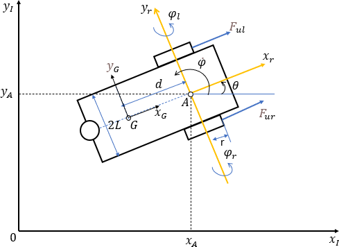
>
> _Hình 2.13: Mô hình robot và các thông số động lực học_
>
> Phương trình động học của một hệ robot di động với hệ tọa độ tổng quát \[q1, q2,…, qn\] được viết:

<table style="width:83%;">
<colgroup>
<col style="width: 67%" />
<col style="width: 15%" />
</colgroup>
<thead>
<tr>
<th style="text-align: right;">
<em>T</em> λ

<blockquote>

<em>M</em> (<em>q</em>)<em>q</em> + <em>V</em> (<em>q</em>, <em>q</em>)<em>q</em> + <em>F</em> (<em>q</em>) + <em>G</em>(<em>q</em>) + τ<em>d</em> = <em>B</em>(<em>q</em>)τ − Λ (<em>q</em>)

</blockquote></th>
<th><blockquote>

( 2-10 )

</blockquote></th>
</tr>
</thead>
<tbody>
</tbody>
</table>

- Trong đó:
  - M(q) là một ma trận hệ số cho các đại lượng gia tốc;

  - 𝑉(𝑞, 𝑞̇) là một ma trận hệ số cho các đại lượng vận tốc;

  - 𝐹(𝑞̇) là ma trận hệ số ma sát bề mặt;

  - G(q) là vector trọng trường;

  - 𝜏𝑑 là vector giới hạn thành phần không xác định;

  - B(q) là ma trận các đại lượng đầu vào;

  - 𝜏 là các đại lượng đầu vào;

  - 𝚲𝑇(𝑞) là ma trận liên quan tới các hạn chế chuyển động;

  - 𝜆 là vector số nhân Lagrange.

- Phương pháp Lagrange được sử dụng để rút ra các phương trình động lực học bằng cách xem xét động năng và thế năng của hệ thống nhất định.

- Động lực học Lagrange :

<table style="width:72%;">
<colgroup>
<col style="width: 49%" />
<col style="width: 21%" />
</colgroup>
<thead>
<tr>
<th><blockquote>

𝑑 𝜕𝐿 𝜕𝐿

( ) + ( ) = 𝐹 − 𝚲𝑇(𝑞)𝜆

𝑑𝑡 𝜕𝑞̇𝑖 𝜕𝑞𝑖

</blockquote></th>
<th><blockquote>

( 2-11 )

</blockquote></th>
</tr>
</thead>
<tbody>
</tbody>
</table>

- Trong đó :
  - L = T-V là hàm Lagrangian đặc trưng cho các thành phần động học như T là động năng của hệ thống hay U là thế năng của hệ thống

  - T là động năng của hệ thống

  - qi là tọa độ tổng quát của hệ thống

  - F là vectơ lực tổng quát

  - 𝚲 là ma trận ràng buộc

  - 𝜆 là vectơ của hệ số nhân Lagrange liên kết với các ràng buộc.

> Việc đầu tiên để tìm ra được mô hình động lực học là phải tìm ra được động năng và thế năng chi phối chuyển động của hệ thống. Mà do robot chỉ di chuyển trên một mặt phẳng nên thế năng bằng 0.
>
> Động năng của hệ thống bằng tổng động năng của bản thân robot khi không có bánh với động năng của bánh xe và thiết bị truyền động (ở đây là động cơ DC)

<table style="width:73%;">
<colgroup>
<col style="width: 51%" />
<col style="width: 21%" />
</colgroup>
<thead>
<tr>
<th><blockquote>

𝑇 = 𝑇𝑐 + 𝑇𝑤 = 𝑇𝑐 + 𝑇𝑤𝑟 + 𝑇𝑤𝑙

</blockquote></th>
<th><blockquote>

( 2-12 )

</blockquote></th>
</tr>
</thead>
<tbody>
</tbody>
</table>

> Động năng của bản thân robot:

<table style="width:66%;">
<colgroup>
<col style="width: 41%" />
<col style="width: 24%" />
</colgroup>
<thead>
<tr>
<th><blockquote>

1 1

𝑇𝐶 = 𝑚𝑐𝑉2 + 𝐼𝑐𝜃̇2

2 𝑐 2

</blockquote></th>
<th><blockquote>

( 2-13 )

</blockquote></th>
</tr>
</thead>
<tbody>
</tbody>
</table>

> Động năng tại 2 bánh bằng động năng của bánh và thiết bị truyền động:

<table style="width:72%;">
<colgroup>
<col style="width: 51%" />
<col style="width: 21%" />
</colgroup>
<thead>
<tr>
<th><blockquote>

1 1 1

</blockquote>

𝑇𝑟 = 𝑚𝑤𝑉2 + 𝐼 𝜃̇2 + 𝐼 𝜑̇2

2 𝑤𝑟 2 𝑚 2 𝑤 𝑟
</th>
<th style="text-align: right;">( 2-14 )</th>
</tr>
</thead>
<tbody>
<tr>
<td><blockquote>

1 1 1

</blockquote>

𝑇𝑙 = 𝑚𝑤𝑉2 + 𝐼 𝜃̇2 + 𝐼𝑤𝜑̇2

2 𝑤𝑙 2 𝑚 2 𝑙
</td>
<td style="text-align: right;">( 2-15 )</td>
</tr>
</tbody>
</table>

- Phương trình vận tốc chung:

<table style="width:61%;">
<colgroup>
<col style="width: 34%" />
<col style="width: 26%" />
</colgroup>
<thead>
<tr>
<th style="text-align: center;">
𝑉2 = 𝑥̇2 + 𝑦̇2

𝑖 𝑖 𝑖
</th>
<th style="text-align: right;">( 2-16 )</th>
</tr>
</thead>
<tbody>
</tbody>
</table>

> Với:

<table style="width:65%;">
<colgroup>
<col style="width: 40%" />
<col style="width: 24%" />
</colgroup>
<thead>
<tr>
<th><blockquote>

{𝑥𝑐 = 𝑥𝑎 + 𝑑𝑐𝑜𝑠(𝜃)

𝑦𝑐 = 𝑦𝑎 + 𝑑𝑠𝑖𝑛(𝜃)

</blockquote></th>
<th style="text-align: right;">( 2-17 )</th>
</tr>
</thead>
<tbody>
<tr>
<td><blockquote>

{𝑥𝑤𝑟 = 𝑥𝑎 + 𝐿𝑠𝑖𝑛(𝜃)

𝑦𝑤𝑟 = 𝑦𝑎 − 𝐿𝑐𝑜𝑠(𝜃)

</blockquote></td>
<td style="text-align: right;">( 2-18 )</td>
</tr>
<tr>
<td><blockquote>

{𝑥𝑤𝑙 = 𝑥𝑎 − 𝐿𝑠𝑖𝑛(𝜃)

𝑦𝑤𝑙 = 𝑦𝑎 + 𝐿𝑐𝑜𝑠(𝜃)

</blockquote></td>
<td style="text-align: right;">( 2-19 )</td>
</tr>
</tbody>
</table>

> Thay phương trình (2-17), (2-18), và (2-19) vào phương trình (2-14), (2-15) và (2-16) ta được phương trình động năng của hệ thống như sau:

<table style="width:94%;">
<colgroup>
<col style="width: 83%" />
<col style="width: 10%" />
</colgroup>
<thead>
<tr>
<th><blockquote>

1 1 1

𝑇 = 𝑚(𝑥̇2 + 𝑦̇2) − 𝑚 𝑑𝜃̇(𝑦̇ 𝑐𝑜𝑠𝜃 − 𝑥̇ 𝑠𝑖𝑛𝜃) + 𝐼 (𝜑̇2 + 𝜑̇2) + 𝐼𝜃̇

2 𝑎 𝑎 𝑐 𝑎 𝑎 2 𝑤 𝑟 𝑙 2

</blockquote></th>
<th><blockquote>

( 2-20 )

</blockquote></th>
</tr>
</thead>
<tbody>
</tbody>
</table>

> Với:
>
> 𝑚 = (𝑚𝑐 + 2𝑚𝑤) là khối lượng của hệ thống tính bằng tổng khối lượng của bản thân xe và khối lượng của 2 bánh xe.

<table style="width:71%;">
<colgroup>
<col style="width: 49%" />
<col style="width: 21%" />
</colgroup>
<thead>
<tr>
<th><blockquote>

𝐼 = 𝐼𝑐 + 𝑚𝑐𝑑2 + 2𝑚𝑤𝐿2 + 2𝐼𝑚

</blockquote></th>
<th><blockquote>

( 2-21 )

</blockquote></th>
</tr>
</thead>
<tbody>
</tbody>
</table>

> 𝐼𝑐 là momen quán tính của robot về trục thẳng đứng qua tâm khối lượng
>
> 𝐼𝑚 là momen quán tính của mỗi động cơ về trục xe
>
> 𝐼𝑤 là momen quán tính của mỗi động cơ về trục bánh xe Sử dụng phương trình (3) với L = T ta được:

<table style="width:79%;">
<colgroup>
<col style="width: 57%" />
<col style="width: 21%" />
</colgroup>
<thead>
<tr>
<th style="text-align: center;">
𝑚𝑥̈𝑎 − 𝑚𝑑𝜃̈𝑠𝑖𝑛𝜃 − 𝑚𝑑𝜃̇2𝑐𝑜𝑠𝜃 = 𝐶1

𝑚𝑦̈𝑎 − 𝑚𝑑𝜃̈𝑐𝑜𝑠𝜃 − 𝑚𝑑𝜃̇2𝑠𝑖𝑛𝜃 = 𝐶2

𝐼𝜃̈ − 𝑚𝑑𝑥̈𝑎𝑠𝑖𝑛𝜃 + 𝑚𝑑𝑦̈𝑎𝑐𝑜𝑠𝜃 = 𝐶3

𝐼𝑤𝜑̈𝑟 = 𝜏𝑟 + 𝐶4

{ 𝐼𝑤𝜑̈𝑙 = 𝜏𝑙 + 𝐶5
</th>
<th><blockquote>

( 2-22 )

</blockquote></th>
</tr>
</thead>
<tbody>
</tbody>
</table>

> Trong đó C1, C2, C3, C4 và C5 là các hệ số liên quan đến các hạn chế trong động học được giới thiệu trong phương trình (2-10).
>
> Ta thay hệ phương trình (2-22) vào phương trình (2-10) ta được:

<table style="width:75%;">
<colgroup>
<col style="width: 54%" />
<col style="width: 20%" />
</colgroup>
<thead>
<tr>
<th><blockquote>

𝑀(𝑞)𝑞̈ + 𝑉(𝑞, 𝑞̇)𝑞̇ = 𝐵(𝑞)𝜏 − 𝚲𝑇(𝑞)𝜆

</blockquote></th>
<th><blockquote>

( 2-23 )

</blockquote></th>
</tr>
</thead>
<tbody>
</tbody>
</table>

> Trong đó:

<table style="width:84%;">
<colgroup>
<col style="width: 68%" />
<col style="width: 15%" />
</colgroup>
<thead>
<tr>
<th style="text-align: right;"><blockquote>

𝑚 0 −𝑚𝑑𝑠𝑖𝑛𝜃 0 0

</blockquote>

⎡ 0 𝑚 𝑚𝑑𝑐𝑜𝑠𝜃 0 0 ⎤

𝑀(𝑞) = ⎢−𝑚𝑑𝑠𝑖𝑛𝜃 𝑚𝑑𝑐𝑜𝑠𝜃 𝐼 0 0 ⎥

<blockquote>

⎢ ⎥

⎢ 0 0 0 𝐼𝑤 0 ⎥

[ 0 0 0 0 𝐼𝑤]

</blockquote></th>
<th>( 2-24 )</th>
</tr>
</thead>
<tbody>
<tr>
<td style="text-align: right;">
⎡0 −𝑚𝑑𝜃̇𝑐𝑜𝑠𝜃 0 0 0⎤

⎢0 −𝑚𝑑𝜃̇𝑠𝑖𝑛𝜃 0 0 0⎥

𝑉(𝑞, 𝑞̇) = ⎢0 0 𝐼 0 0⎥

<blockquote>

⎢0 0 0 0 0⎥

[0 0 0 0 0]

</blockquote></td>
<td>( 2-25 )</td>
</tr>
</tbody>
</table>

𝐵(𝑞) =

> 0 0
>
> ⎡0 0⎤
>
> 0 0
>
> ⎢1 0⎥
>
> \[0 1\]

<table style="width:72%;">
<colgroup>
<col style="width: 51%" />
<col style="width: 21%" />
</colgroup>
<thead>
<tr>
<th><blockquote>

−𝑠𝑖𝑛𝜃 𝑐𝑜𝑠𝜃 𝑐𝑜𝑠𝜃

⎡ 𝑐𝑜𝑠𝜃 𝑠𝑖𝑛𝜃 𝑠𝑖𝑛𝜃⎤

𝚲𝑇(𝑞)𝜆 = 0 0 0

⎢ 0 0 0 ⎥

[ 0 0 0 ]

</blockquote></th>
<th><blockquote>

( 2-26 )

</blockquote></th>
</tr>
</thead>
<tbody>
</tbody>
</table>

> Để thuận tiện cho mục đích điều khiển và mô phỏng ta loại bỏ các hạn chế trong
>
> chuyển động ngắn bớt:
>
> Λ*T* (_q_)λ . Điều này được thực hiện bằng cách xác định vecto được làm

<table style="width:58%;">
<colgroup>
<col style="width: 30%" />
<col style="width: 28%" />
</colgroup>
<thead>
<tr>
<th><blockquote>

𝜂 = [𝜑̇𝑟]

𝜑̇𝑙

</blockquote></th>
<th style="text-align: right;">( 2-27 )</th>
</tr>
</thead>
<tbody>
</tbody>
</table>

> Ta biểu thị ma trận vận tốc bằng phương trình động học:

<table style="width:75%;">
<colgroup>
<col style="width: 55%" />
<col style="width: 19%" />
</colgroup>
<thead>
<tr>
<th><blockquote>

𝑅 𝑅

⎡ . cos(𝜃) . cos (𝜃)⎤

𝑥̇𝑎 ⎢2 2 ⎥

⎡𝑦̇𝑎 ⎤ ⎢ 𝑅 . sin(𝜃) 𝑅 . sin (𝜃) ⎥

⎢ ⎥ 1 𝜑̇𝑟

⎢ 𝜃̇ ⎥ = 2 ⎢ 2 𝑅 2 𝑅 ⎥ [𝜑̇ ]

⎢𝜑̇𝑟⎥ ⎢ − ⎥ 𝑙

[𝜑̇ ] ⎢ 2𝐿 2𝐿 ⎥

</blockquote>

𝑙 ⎢ 2 0 ⎥

[ 0 2 ]
</th>
<th><blockquote>

( 2-28 )

</blockquote></th>
</tr>
</thead>
<tbody>
</tbody>
</table>

> Phương trình (2-28) có thể viết thành:

<table style="width:59%;">
<colgroup>
<col style="width: 31%" />
<col style="width: 27%" />
</colgroup>
<thead>
<tr>
<th><blockquote>

𝑞̇ = 𝑆(𝑞)𝜂

</blockquote></th>
<th style="text-align: right;">( 2-29 )</th>
</tr>
</thead>
<tbody>
</tbody>
</table>

> Có thể chứng minh rằng ma trận biến đổi S(q) là không xác định trong không gian với các hạn chế 𝚲𝑇(𝑞)𝜆 do đó ta có:

<table style="width:63%;">
<colgroup>
<col style="width: 36%" />
<col style="width: 26%" />
</colgroup>
<thead>
<tr>
<th><blockquote>

𝑆𝑇(𝑞)𝚲𝑇(𝑞) = 0

</blockquote></th>
<th><blockquote>

( 2-30 )

</blockquote></th>
</tr>
</thead>
<tbody>
</tbody>
</table>

> Đạo hàm theo thời gian phương trình (2-29) ta được:

<table style="width:65%;">
<colgroup>
<col style="width: 39%" />
<col style="width: 25%" />
</colgroup>
<thead>
<tr>
<th><blockquote>

𝑞̈ = 𝑆̇(𝑞)𝜂 + 𝑆(𝑞)𝜂̇

</blockquote></th>
<th><blockquote>

( 2-31 )

</blockquote></th>
</tr>
</thead>
<tbody>
</tbody>
</table>

> Thay phương trình (2-29) và (2-31) vào (2-23) ta được:

<table style="width:88%;">
<colgroup>
<col style="width: 74%" />
<col style="width: 13%" />
</colgroup>
<thead>
<tr>
<th><blockquote>

𝑀(𝑞)[𝑆̇(𝑞)𝜂 + 𝑆(𝑞)𝜂̇] + 𝑉(𝑞, 𝑞̇)[𝑆(𝑞)𝜂] = 𝐵(𝑞)𝜏 − 𝚲𝑇(𝑞)𝜆

</blockquote></th>
<th><blockquote>

( 2-32 )

</blockquote></th>
</tr>
</thead>
<tbody>
</tbody>
</table>

> Nhân cả 2 vế với 𝑆𝑇(𝑞) ta được:
>
> 𝑆𝑇(𝑞)𝑀(𝑞)\[𝑆̇(𝑞)𝜂 + 𝑆(𝑞)𝜂̇\] + 𝑉(𝑞, 𝑞̇)\[𝑆(𝑞)𝜂\] = 𝑆𝑇(𝑞)𝐵(𝑞)𝜏 − 𝑆𝑇(𝑞)𝚲𝑇(𝑞)𝜆
>
> Như phương trình (2-30) 𝑆𝑇(𝑞)𝚲𝑇(𝑞) = 0 do đó ta có:
>
> ⎡𝐼𝑤 +
>
> 𝑆𝑇(𝑞)𝑀(𝑞)𝑆(𝑞) = ⎢
>
> 𝑟2
>
> 4𝑏2
>
> (𝑚𝑏2 + 𝐼)
>
> 𝑟2
>
> 4𝑏2

(𝑚𝑏2 − 𝐼) ⎤

⎥

\]

\[ 4𝑏2

> (𝑚𝑏2 − 𝐼) 𝐼𝑤 +
>
> 𝑟2
>
> 4𝑏2
>
> (𝑚𝑏2 − 𝐼)⎥

𝑟2

> ⎡ 0 2𝑏 𝑚𝑐𝑑𝜃̇⎤

𝑆𝑇(𝑞)\[𝑀(𝑞)𝑆̇(𝑞) + 𝑉(𝑞, 𝑞̇)𝑆(𝑞)\] = ⎢

⎢

> ⎥
>
> 𝑟2 ⎥
>
> \[− 2𝑏 𝑚𝑐𝑑𝜃̇ 0 \]

𝑆𝑇(𝑞)𝐵(𝑞) = \[1 0\]

> 0 1
>
> − **Do đó ta có phương trình động lực học Lagrange:**

<table style="width:92%;">
<colgroup>
<col style="width: 80%" />
<col style="width: 11%" />
</colgroup>
<thead>
<tr>
<th style="text-align: center;"><blockquote>

2𝐼𝑤 1

</blockquote>

(𝑚𝑐 + 2𝑚𝑤 + ) 𝑉̇ − 𝑚𝑐𝑑𝜔2 = (𝜏𝑟 + 𝜏𝑙)

<blockquote>

𝑅2 𝑅

2𝐿2 𝐿

</blockquote>

(𝐼𝑐 + 𝑚𝑐𝑑2 + 2𝑚𝑤𝐿2 + 2𝐼𝑚 + 𝐼𝑤) 𝜔̇ + 𝑚𝑐𝑑𝜔𝑉 = (𝜏𝑟 − 𝜏𝑙)

{ 𝑅2 𝑅
</th>
<th><blockquote>

( 2-33 )

</blockquote></th>
</tr>
</thead>
<tbody>
</tbody>
</table>

> 𝑅(𝜏𝑟 + 𝜏𝑙) + 𝑅2𝑚𝑐𝑑𝜔2 𝜏𝑟 + 𝜏𝑙 + 𝑅𝑚𝑐𝑑𝜔2
>
> ⎛ 𝑉̇ =
>
> ⎪
>
> ⇔
>
> 𝑅2(𝑚𝑐
>
> \+ 2𝑚𝑤

) + 2𝐼𝑤

> =
>
> 𝑅(𝑚𝑐 + 2𝑚𝑤) +
>
> <u>2𝐼</u>𝑤
>
> 𝑅
>
> ⎨ 𝑅𝐿(𝜏𝑟 − 𝜏𝑙) − 𝑅2𝑚𝑐𝑑𝜔𝑉
>
> 𝐿(𝜏𝑟 − 𝜏𝑙) − 𝑅𝑚𝑐𝑑𝜔𝑉
>
> ⎪𝜔̇ = (𝐼
>
> \+ 𝑚
>
> 𝑑2 + 2𝑚
>
> 𝐿2 + 2𝐼
>
> )𝑅2 + 2𝐿2𝐼 =
>
> 2𝐿2𝐼
>
> 𝑐 𝑐
>
> {
>
> 𝑤 𝑚
>
> 𝑤 (𝐼𝑐 + 𝑚𝑐𝑑2 + 2𝑚𝑤𝐿2 + 2𝐼𝑚)𝑅 + 𝑅 𝑤

# CHƯƠNG 3: TÍNH TOÁN, THIẾT KẾ HỆ THỐNG

## Thiết kế sơ đồ tổng thể hệ thống

1.  **Sơ đồ tổng thể hệ thống**

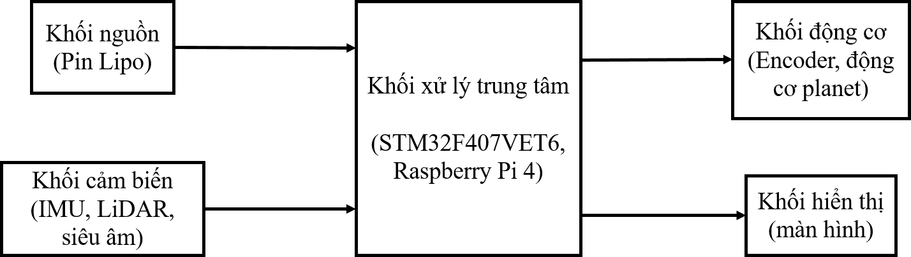

> _Hình 3.1: Sơ đồ khối hệ thống_

2.  **Chức năng của từng khối**
    - Khối nguồn: có nhiệm vụ cung cấp nguồn 1 chiều ổn định cho khối xử lý trung tâm hoạt động.

    - Khối cảm biến: gồm các thiết bị dùng để thu nhận các tín hiệu từ môi trường bên ngoài: cảm biến IMU giúp xác định góc quay của robot; cảm biến LiDAR có chức năng quét bản đồ, xác định hướng di chuyển kết hợp với cảm biến siêu âm giúp robot tránh vật cản cho robot.

    - Khối xử lý trung tâm: Raspberry Pi 4 dùng để nhận dữ liệu quét được từ LiDAR thông qua Rviz và hiển thị bản đồ trên màn hình, vi điều khiển STM32F407VET6 dùng để lập trình điều khiển robot di chuyển đúng ý muốn.

    - Khối động cơ: Có chức năng truyền động cho các bánh xe để robot di chuyển, gửi và nhận tín hiệu xung từ encoder.

    - Khối hiển thị: hiển thị trực tiếp trên màn hình máy tính.

<!-- -->

2.  **Tính toán, thiết kế hệ thống cơ khí**

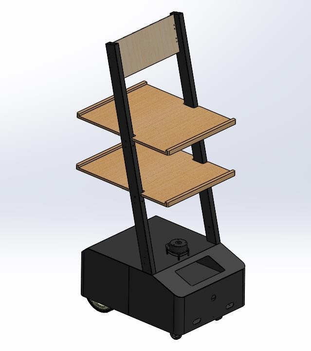

> _Hình 3.2: Bản vẽ thiết kế hệ thống cơ khí của mô hình_
>
> Hình 4.2 và 4.3 là mô hình cơ khí của hệ thống robot di động phục vụ lễ tân. Các thành phần chính của hệ thống bao gồm: 1. Thân vỏ xe Mobile Robot, 2. Nắp xe, 3. Khung giá, 4. Khay dưới, 5. Gá chữ L, 6. Phần đáy xe, 8. Gá động cơ, 9. Bánh tự lựa,
>
> 10\. Động cơ Planet, 11. Bánh xe, 12. Gá chữ L, 13. Khay trên, 14. Gá màn hình, 15. Gá chữ L, 16. Lidar. Thiết kế chi tiết cho các cụm chi tiết chính được thể hiện trong phần phụ lục. Trong phần này, tính toán lựa chọn một số chi tiết chính trong phần cơ khí của Mô hình Mobile Robot được trình bày.
>
> 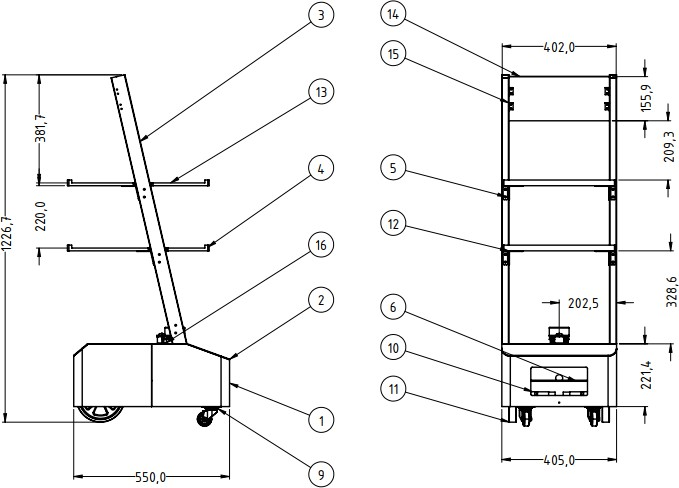
>
> _Hình 3.3: Các thành phần cơ bản của mô hình cơ khí_

1.  **Tính toán lựa chọn bánh xe**

> Bánh xe động lực: Bánh động lực cần phải chịu tải tốt, ma sát giữa bánh với mặt đất phải lớn để tránh bị trượt khi di chuyển gây ra sự không ổn định của xe trong quá trình làm việc. Dựa vào khối lượng các linh điện và khung xe trong quá trình làm việc nhóm chọn bánh động lực có kích thước như sau: Đường kính bánh xe 150mm, có phần khung làm từ nhựa đủ khả năng chịu tải tốt, đồng thời lớp vỏ ngoài là cao su chia làm các rãnh làm tăng ma sát.
>
> Bánh dẫn hướng: hay còn gọi là bánh xe tự lựa giúp robot điều chỉnh hướng đi. Quay trái, quay phải, linh hoạt hơn.
>
> 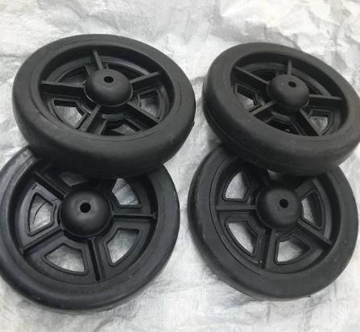
>
> _Hình 3.4: Bánh xe dẫn động_

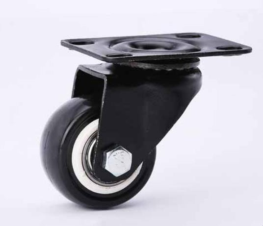

> _Hình 3.5: Bánh xe dẫn hướng bị động_

2.  **Tính toán chọn động cơ**

> Địa hình làm việc của robot là địa hình phẳng, giả thiết bỏ qua sự biến dạng của bánh xe, bỏ qua lực cản của không khí trong quá trình robot di chuyển.
>
> Các thông số của robot:

- Khối lượng ước tính: M = 15 (kg).

- Khối lượng hàng hoá tối đa: 18 (kg).

- Chọn bánh xe có đường kính: 2r = 150 (mm).

- Chọn tốc độ tối đa là: 0,5 (m/s).

- Thông số cơ bản của bánh xe là: đường kính 150 (mm), bề rộng của bánh xe là 30 (mm), tải trọng tối đa 43 (kg).

> Phân tích lực tác động lên một bánh xe chủ động gồm 4 lực tác dụng như sau:

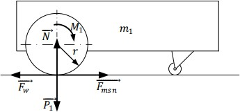

> _Hình 3.6: Phân tích các lực tác dụng lên xe_
>
> Trong đó:

- 𝐹⃗𝑚𝑠𝑛 là lực ma sát nghỉ giữa bánh xe và bề mặt sàn.

- 𝐹⃗𝑤 là lực kéo sinh ra do momen động cơ.

- 𝑁⃗⃗ là phản lực của mặt sàn.

- 𝑃⃗1 là một nửa trọng lực của xe (P1 = P/2).

- 𝑀⃗⃗1 là momen xoắn cho động cơ.

- 𝑚1 là một nửa tổng trọng lượng của robot và hàng (m1 = m/2).

> Chọn phương án chuyển động của robot là chuyển động thẳng, hai bánh dẫn động di chuyển cùng tốc độ về phía trước với 𝑣 = 0,5 (m/s). Tốc độ quay của bánh xe là:

𝑛 =

> 60 × 1000 × 𝑣
>
> 2𝜋𝑟
>
> 60 × 1000 × 0.5
>
> =
>
> 150𝜋
>
> = 63.69 (𝑟𝑝𝑚)
>
> Phương trình cân bằng lực:

<table style="width:68%;">
<colgroup>
<col style="width: 46%" />
<col style="width: 21%" />
</colgroup>
<thead>
<tr>
<th><blockquote>

𝐹⃗𝑚𝑠𝑛 + 𝐹⃗𝑤 + 𝑁⃗⃗ + 𝑃⃗1 = 𝑚1𝑎⃗

</blockquote></th>
<th><blockquote>

( 3-1 )

</blockquote></th>
</tr>
</thead>
<tbody>
</tbody>
</table>

> Với 𝑎⃗ là gia tốc của xe.
>
> **Khi xe chuyển động đều**
>
> Vận tốc không đổi 𝑣 = 0,5 (m/s) nên gia tốc a = 0 (m/s2). Khi đó:

<table style="width:77%;">
<colgroup>
<col style="width: 59%" />
<col style="width: 17%" />
</colgroup>
<thead>
<tr>
<th><blockquote>

𝑃1 𝑚1𝑔 42.2 × 9.8

𝑁 = = = = 206.7 (𝑁)

2 2 2

</blockquote></th>
<th><blockquote>

( 3-2 )

</blockquote></th>
</tr>
</thead>
<tbody>
</tbody>
</table>

> Lực kéo sinh ra do momen của động cơ là:

<table style="width:79%;">
<colgroup>
<col style="width: 62%" />
<col style="width: 16%" />
</colgroup>
<thead>
<tr>
<th><blockquote>

𝐹𝑤 = 𝐹𝑚𝑠𝑛 = 𝜇𝑙𝑁 = 0.015 × 206.7 = 3.1 (𝑁)

</blockquote></th>
<th><blockquote>

( 3-3 )

</blockquote></th>
</tr>
</thead>
<tbody>
</tbody>
</table>

> Với hệ số ma sát lăn 𝜇𝑙 = 0.015 khi di chuyển trên sàn bê tông. Công suất cần thiết để xe di chuyển ổn định với vận tốc 0.5 (m/s) là:

<table style="width:74%;">
<colgroup>
<col style="width: 54%" />
<col style="width: 19%" />
</colgroup>
<thead>
<tr>
<th><blockquote>

𝑃1 = 𝐹𝑤 × 𝑣 = 3.1 × 0.5 = 1.55 (𝑊)

</blockquote></th>
<th><blockquote>

( 3-4 )

</blockquote></th>
</tr>
</thead>
<tbody>
</tbody>
</table>

> **Khi xe tăng tốc**
>
> Xe tăng tốc với gia tốc a = 0.5 (m/s2) để hàng không rơi. Lực kéo sinh ra do momen của động cơ là:

<table style="width:92%;">
<colgroup>
<col style="width: 82%" />
<col style="width: 10%" />
</colgroup>
<thead>
<tr>
<th><blockquote>

𝐹𝑤 = 𝐹𝑚𝑠𝑛 + 𝑚1𝑎 = 𝜇𝑛𝑁 + 𝑚1𝑎 = 1 × 206.7 + 42 × 0.5 = 228 (𝑁)

</blockquote></th>
<th><blockquote>

( 3-5 )

</blockquote></th>
</tr>
</thead>
<tbody>
</tbody>
</table>

> Với hệ số ma sát tĩnh 𝜇𝑛 = 1
>
> Momen xoắn cần thiết để xe tăng tốc là:

<table style="width:75%;">
<colgroup>
<col style="width: 57%" />
<col style="width: 18%" />
</colgroup>
<thead>
<tr>
<th><blockquote>

𝑀1 = 𝐹𝑤𝑟 = 228 × 0.035 = 7.98 (𝑁𝑚)

</blockquote></th>
<th><blockquote>

( 3-6 )

</blockquote></th>
</tr>
</thead>
<tbody>
</tbody>
</table>

> Công suất cần thiết để tăng tốc lên 0.5 (m/s) là:

<table style="width:72%;">
<colgroup>
<col style="width: 52%" />
<col style="width: 19%" />
</colgroup>
<thead>
<tr>
<th><blockquote>

𝑃1 = 𝐹𝑤𝑟 = 228 × 0.5 = 114 (𝑊)

</blockquote></th>
<th><blockquote>

( 3-7 )

</blockquote></th>
</tr>
</thead>
<tbody>
</tbody>
</table>

> Như vậy, công suất động cơ cần thiết là 114W và tốc độ động cơ yêu cầu là 63rpm.
>
> Nên chọn động cơ giảm tốc với tốc độ 70rpm sử dụng điện áp 24V, công suất 120W.

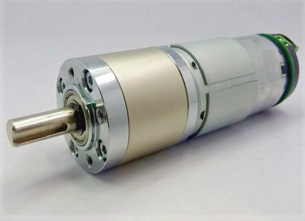

> _Hình 3.7: Động cơ giảm tốc planet_

## Tính toán, thiết kế hệ thống điều khiển

1.  **Nguyên lý hệ thống điều khiển**

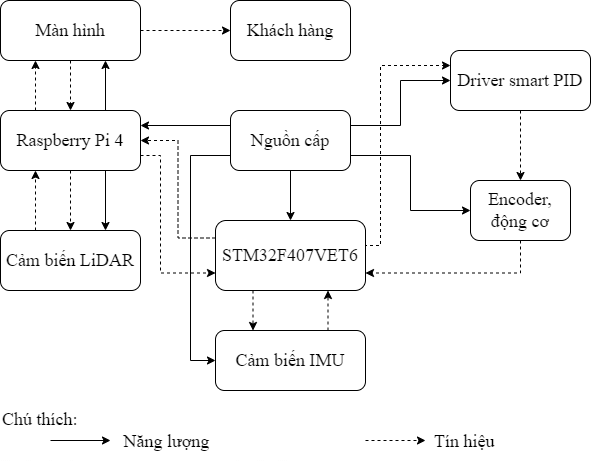

> _Hình 3.8: Sơ đồ tổng thể hệ thống điều khiển_
>
> Sơ đồ hệ thống điện có dạng như hình vẽ với thiết bị điều khiển chính là STM32. Các cảm biến đầu vào là cảm biến LiDAR, IMU. Các thiết bị đầu ra bao gồm loa âm thanh, màn hình HMI, driver và động cơ. Nguồn cấp là pin Lithium 24V giúp hệ thống duy trì hoạt động ổn định.

2.  **Thiết bị điều khiển và phần mềm lập trình**

> _a, Mạch điều khiển trung tâm_

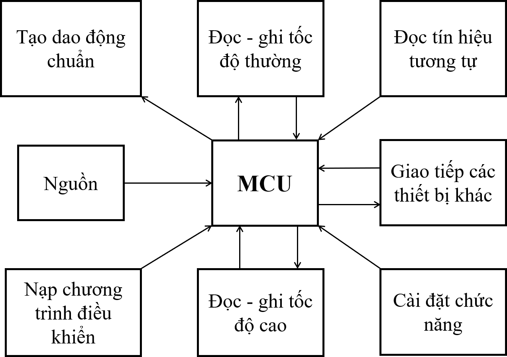

> _Hình 3.9: Sơ đồ khối hệ thống điều khiển trung tâm_
>
> Loại vi điều khiển được sử dụng là STM32F407VET6 do nhóm tự thiết kế và chế tạo. Vi điều khiển STM32F407VET6 là loại được sử dụng ở rất nhiều trường đại học hiện nay trong giảng dạy và nghiên cứu, vi điều khiển có thiết kế ra chân đầy đủ với các ngoại vi cơ bản: USB, MicroSD, Flash, Pin RTC...và cổng nạp chuẩn Jtag tích hợp. Bản vẽ nguyên lí chi tiết về mạch điều khiển được thế hiện ở phần Phụ lục.
>
> 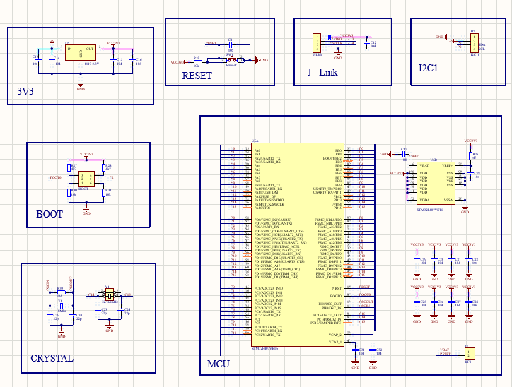

_Hình 3.10: MCU STM32F407 thiết kế trên phần mềm Altium Designer_

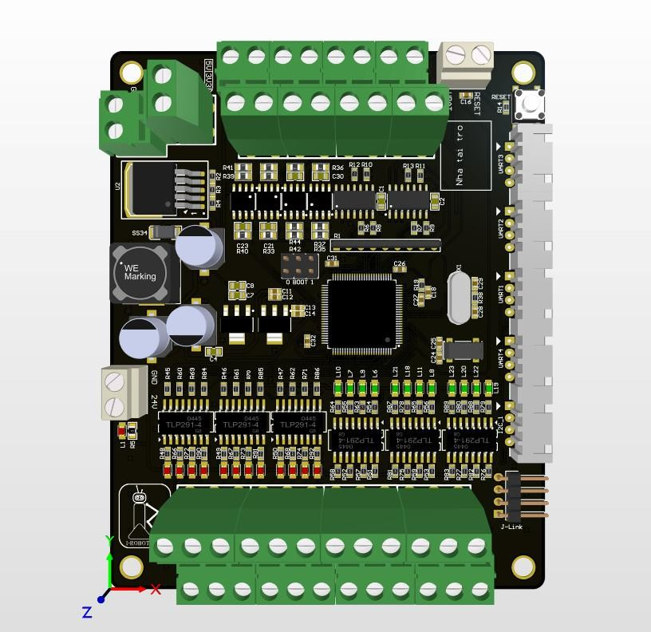

_Hình 3.11: Board mạch vi điều khiển STM32F407VET6_

> **Thông số kỹ thuật:**

- Vi điều khiển chính: STM32F407VET6 (32-bit RISC Cortex-M4 Kernel, 512kB Flash Storage, 192kBRAM + 4kBSRAM, LQFP100 Package).

- Nguồn cấp từ cổng Mini USB qua các IC nguồn chuyển thành 3v3 để cấp cho MCU.

- Có sẵn các chân nguồn: 3V và 5V.

- Thạch anh: 168MHz, 210 DMIPS/1.25 DMIPS/MHz.

- Điện áp hoạt động: 1.8-3.6V.

- Chuẩn truyền thông: 3 SPI, 2 UART, 4 USART, 3 I2C, 2 I2S, 1 FSMC, 1 SDIO, 2 CAN, LX, USB 2 controller FS/HS ( with DMA) HSULPII USB (DM USB for HS PHY).

- 1x 10/100 Ethernet MAC.

- 1x 8 to 12-bit parallel camera interface.

- 3x ADC (12, LUS, time 24), 2xDAC (12bit).

> _b, Phần mềm lập trình_
>
> STM32F407VET6 sử dụng phần mềm KielC V5. KeilC V5 là một trong những IDE tốt nhất hiện nay được các lập trình viên sử dụng để phát triển code cho dòng vi điều khiển lõi ARM do hãng ST phát hành.

> _Hình 3.12: Giao diện phần mềm KeilC V5_
>
> _c, Driver Smart PID_

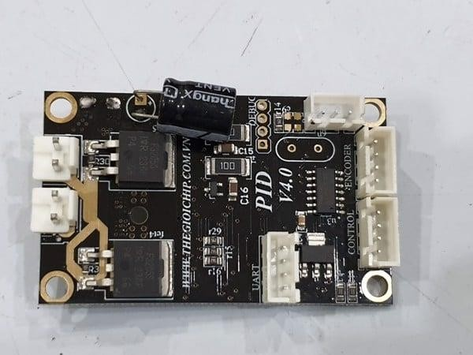

> _Hình 3.13: Drive Smart PID V4.0_
>
> Driver được trang bị bộ vi xử lý ARM hiện đại nhất nên cung cấp nhiều chức năng cao cấp như sau:

- Chạy động cơ công suất lớn tới 700W, điện áp điều khiển 24VDC.

- Giao tiếp máy tính qua cổng COM, UART.

- Đèn LED báo trạng thái hoạt động.

- Chạy PID vị trí theo chuẩn 1 xung và 1 hướng hỗ trợ tần số lên tới 10 MHz, ứng dụng làm máy CNC, với các thông sô Kp, Kd, Ki điều chỉnh được bằng giao diện máy tính.

- Chạy PID vị trí theo chuẩn xung encoder AB hỗ trợ tần số lên tới 10 MHz, ứng dụng làm cánh tay máy , với các thông sô Kp, Kd, Ki điều chỉnh được bằng giao diện máy tính.

- Chạy PID vận tốc hỗ trợ các chuẩn giao tiếp: 1 PWM (tích cực mức 0 với độ phân giải 8 bit) và 1 hướng, hỗ trợ tần số điều xung (50 Hz – 5 KHz).

- UART với khung truyền 3 byte (byte đầu là thuộc tính gồm chiều quay bit thứ 7 và các bit còn lại là địa chỉ, byte giữa là tốc độ, byte cuối luôn luôn là 0xFF). Hỗ trợ giao tiếp mọi tốc độ baudrate và tối đa lên đến 128 thiết bị mà chỉ tốn 1 dây điều khiển từ mater, có giao diện tùy chọn cho người sử dụng.

- Có chức năng thông minh là chỉ cần bạn nhập thông số tốc độ max của động cơ tính theo vòng/phút và xung encoder quay được 1 vòng thì bộ điều khiển sẽ tự tính toán ra hết các hệ số Kp, Kd, Ki.

- Hỗ trợ chạy động cơ lên tới 20000 vòng/phút và encoder 20000 xung/vòng.

- Chạy theo chuẩn cầu H đơn thuần không cần encoder, cũng có 3 chuẩn giao tiếp PWM, UART.

> _d, Module LM2596_
>
> Là module giảm áp có khả năng điều chỉnh được dòng ra đến 3A. LM2596 là IC nguồn tích hợp đầy đủ bên trong. Tức là khi cấp nguồn 9V vào module, sau khi giảm áp ta có thể lấp được nguồn 3A \< 9v... như 5V hay 3.3V.

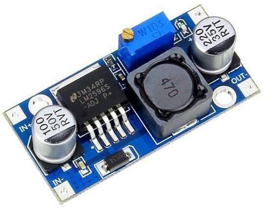

> _Hình 3.14: Module LM2596_
>
> **Thông số kỹ thuật:**

- Module nguồn không sử dụng cách ly.

- Nguồn đầu vào từ 4V - 35V.

- Nguồn đầu ra: 1V - 30V.

- Dòng ra Max: 3A.

- Kích thước mạch: 53mm x 26mm.

> _e, Động cơ giảm tốc_

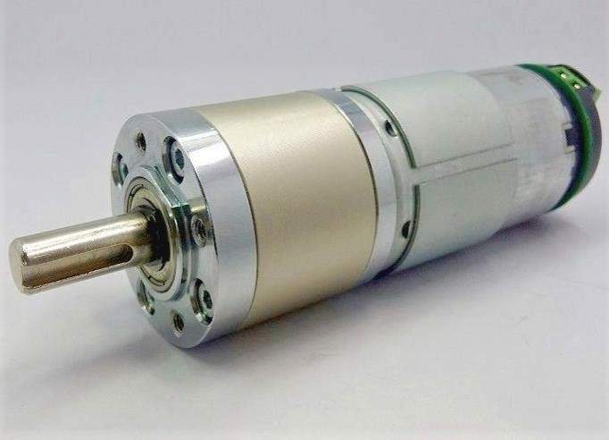

> _Hình 3.15: Động cơ giảm tốc planet 24V_

- Tên sản Phẩm: Động cơ hộp số hành tinh - động cơ cho robocon Planet 24V.

- Hộp số động cơ dùng bánh răng vệ tinh nên rất bền bỉ yên tâm khi sử dụng.

- Thích hợp dùng trong các cơ cấu băng tải, robocon và 1 số chi tiết trong các loại máy công cụ, ô tô…

- Thông số kỹ thuật:
  - Động cơ servo DC 24V, 120W.

  - Điện áp cấp vào 24V, 468 vòng/phút.

  - Lực kéo 15kgf/cm.

  - Encoder 7 or 13 xung/vòng sử dụng nguồn 3.3v – 5volt.

  - Đường kính ngoài 42mm, đường kính trục 10mm.

  - Dòng khi có tải \< 6.5A.

## Lập bản đồ sử dụng LiDAR

1.  **Cài đặt và thiết lập hệ thống**

> \- B1: Cài đặt hệ điều hành Ubuntu 20.04 LTS desktop cho Raspberry pi 4
>
> Ubuntu 20.04 LTS là phiên bản mới nhất mà **Canonical** đã phát hành vào cuối tháng 04/2020. Trong bản cập nhật này bổ sung thêm một số tính năng mới, sử dụng kernel 5.4, cải thiện độ ổn định hơn. Là phiên bản hỗ trợ ROS

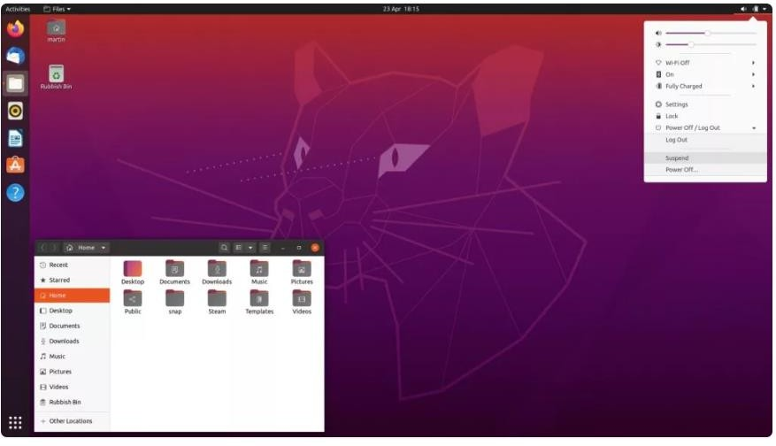

> _Hình 3.16: Giao diện Ubuntu 20.04 LTS Desktop_

- B2: Cài phần mềm Gazebo và Rviz trên Ras pi

> Gazebo là một chương trình mô phỏng đa robot 3 chiều trong nhà và ngoài trời, hỗ trợ vật lý động học và động lực học nhiều phương tiện khác. Các trình cắm Gazebo giúp kết hợp ROS và Gazebo với nhau để hỗ trợ nhiều loại robot và cảm biến. Vì các trình cắm này biểu diễn cùng giao diện thông điệp với hệ thống ROS nên ra có thể viết các node của ROS hoàn toàn tương thích với bộ mô phỏng, dữ liệu ghi nhật lý và phần cứng, cũng như có thể phát triển ứng dụng rồi thử nghiệm cho robot trong môi trường thực tế
>
> 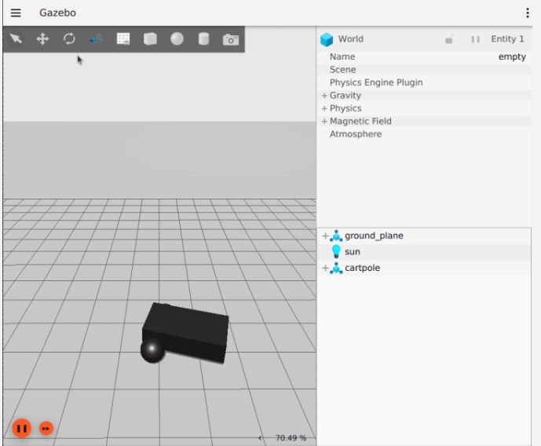

_Hình 3.17: Gazebo in ROS_

> \- B3: Mô phỏng quét bản đồ LIDAR trên Gazebo

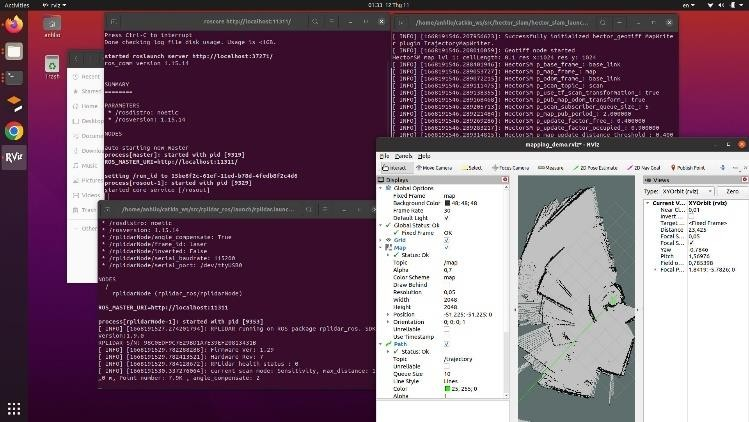

_Hình 3.18: Mô phỏng quét bản đồ nhờ cảm biến LiDAR_

> Kiểm tra dữ liệu /tf: rostopic echo /tf

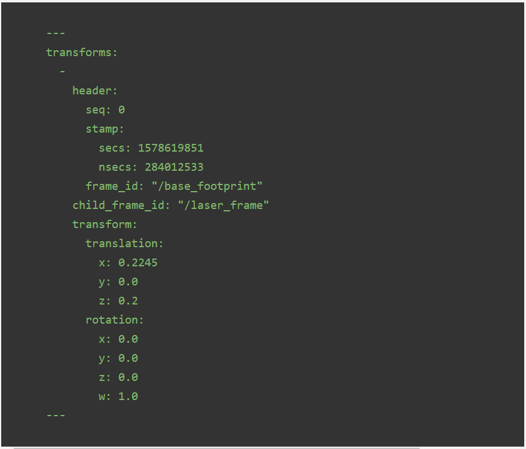

_Hình 3.19: Kết quả kiểm tra dữ liệu /tf_

> Kiểm tra dữ liệu /scan:

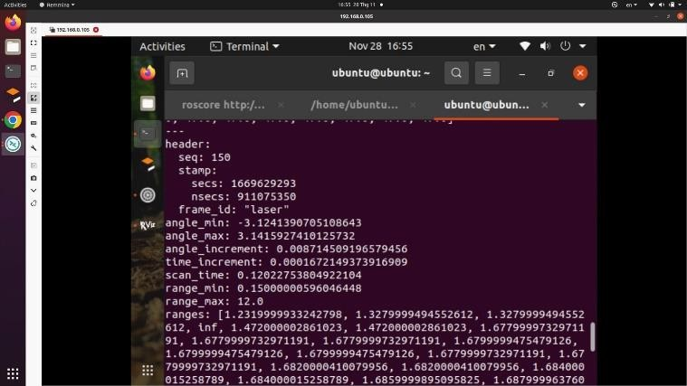

_Hình 3.20: Kết quả kiểm tra dữ liệu /scan_

> Kết quả sau khi cài đặt và thiết lập hệ thống:
>
> 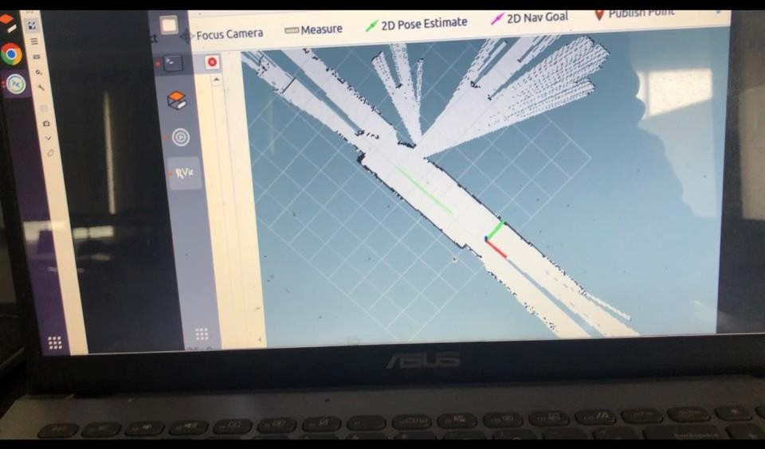
>
> _Hình 3.21: Quét bản đồ thực sau khi cài đặt hệ thống_

1.  **Lập bản đồ sử dụng LiDAR**
    - Lưu đồ :

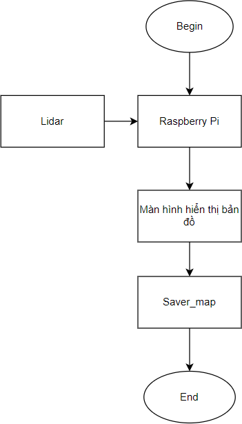

> _Hình 3.22: Lưu đồ sử dụng lidar lập bản đồ_

2.  **Chuyển đổi dữ liệu từ LiDAR sang vi điều khiển STM32f1**
    - Lưu đồ thuật toán của cả hệ thống

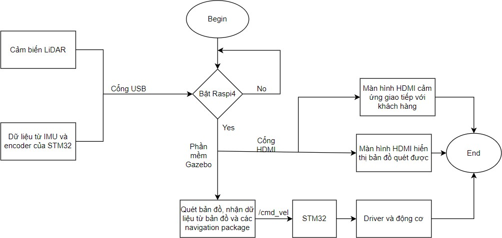

> _Hình 3.23: Lưu đồ sử dụng Lidar lập bản đồ và điều khiển động cơ_
>
> \- Navigation package tổng hợp dữ liệu và xử lý trên raspberry pi

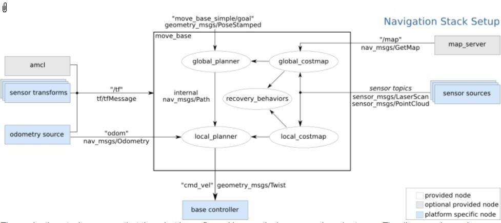

> _Hình 3.24: Sơ đồ topic của bài toán navigation_
>
> Sơ đồ trên cho thấy tổng quan về cấu hình này. Các thành phần màu trắng là các thành phần bắt buộc đã được triển khai, các thành phần màu xám là các thành phần tùy chọn đã được triển khai và các thành phần màu xanh lam phải được tạo cho mỗi nền tảng robot. Các điều kiện tiên quyết của navigation stack, cùng với hướng dẫn về cách đáp ứng từng yêu cầu, được cung cấp bao gồm:

1.  ROS

2.  Transform Configuration

3.  Sensor Information (Sensor sourses)

4.  Odometry Information (Odometry source)

5.  Base Controller

6.  Mapping (map_server)

> _a, Transform Configuration (Chuyển đổi cấu trúc)_
>
> Xác định hai khung tọa độ : điểm trung tâm của đế robot(base_link) ; điểm trung tâm của Lidar (base_laser). Xác định khoảng cách ( tọa độ) giữa 2 base.
>
> Ví dụ như hình 3.8: Giả sử chúng ta biết rằng tia laze được gắn về phía trước 10 cm và cao hơn 20 cm so với tâm của đế di động. Điều này mang lại cho chúng tôi một độ lệch tịnh tiến liên quan đến khung "base_link" với khung "base_laser". Cụ thể, chúng tôi biết rằng để lấy dữ liệu từ khung "base_link" sang khung "base_laser", chúng tôi phải áp dụng phép dịch (x: 0,1m, y: 0,0m, z: 0,2m) và để lấy dữ liệu từ " khung base_laser" sang khung "base_link" chúng ta phải áp dụng phép dịch ngược lại (x: -0,1m, y: 0,0m, z: -0,20m).

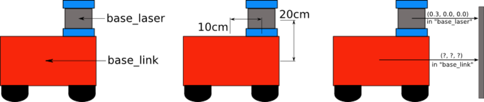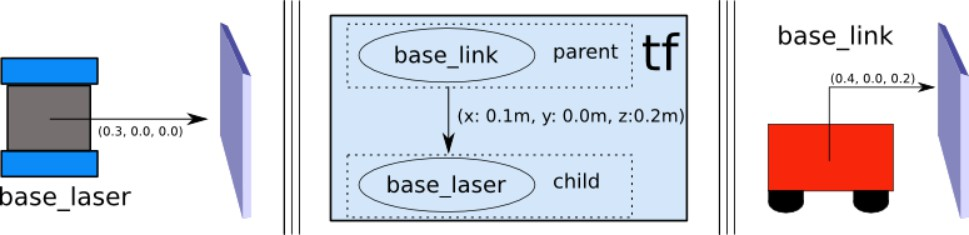

> _Hình 3.25: Ví dụ về khoảng cách giữa 2 khung tọa độ_
>
> Code trên terminal:

> Bây giờ chúng ta đã có gói của mình, chúng ta cần tạo node thực hiện công việc biến đổi base_laser → base_link qua ROS. Trong gói robot_setup_tf vừa tạo, kích hoạt trình chỉnh sửa và dán đoạn mã sau vào tệp src/tf_broadcaster.cpp :

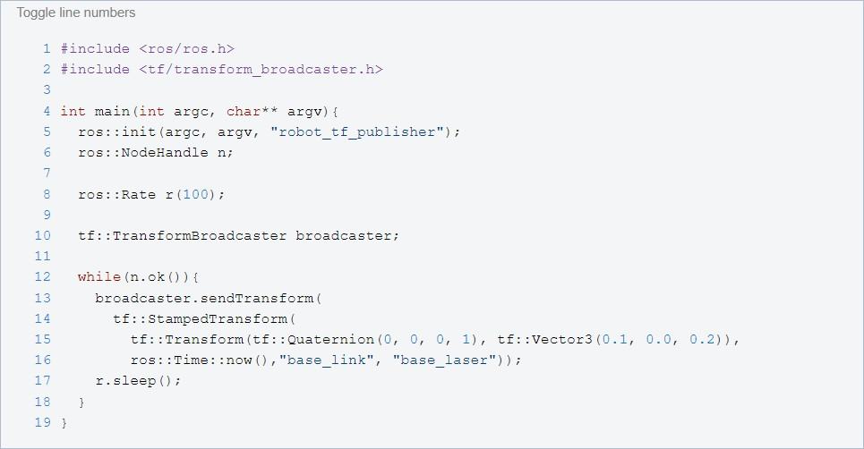

> _b, Sensor Information (Nguồn cảm biến)_
>
> Nếu Navigation stack không có thông tin từ các cảm biến của robot thì robot sẽ bị mù và rất có thể sẽ va phải vật cản. Trong dự án này, các cảm biến cung cấp thông tin cho navigation stack bao gồm: cảm biến Lidar, cảm biến đo góc IMU, encoder. Do dự án sử dụng công nghệ quét bản đồ 2D nên dữ liệu của cảm biến sẽ được cung cấp qua sensor_msgs/LaserScan

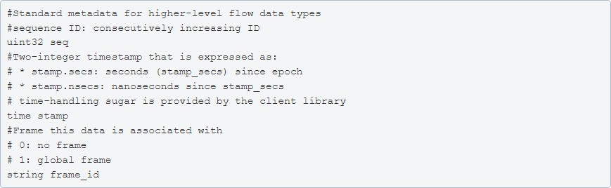

> Đối với rô bốt có máy quét laze, ROS cung cấp một loại tin nhắn đặc biệt trong gói sensor_msgs có tên là _[<u>LaserScan</u>](http://wiki.ros.org/sensor_msgs)_ để chứa thông tin về một lần quét nhất định. Thông báo _LaserScan_ giúp mã dễ dàng hoạt động với hầu hết mọi loại laser miễn là dữ liệu quay lại từ máy quét có thể được định dạng để phù hợp với thông báo. Một số đặc điểm kỹ thuật của LaserScan:
>
> 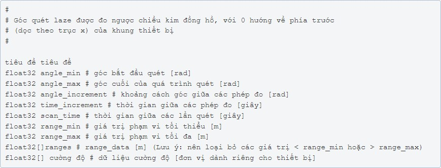
>
> Xuất bản một thông báo LaserScan qua ROS khá đơn giản. Trước tiên, chúng ta cung cấp mã mẫu bên dưới để thực hiện điều đó và sau đó chia nhỏ mã xuống từng dòng một:
>
> 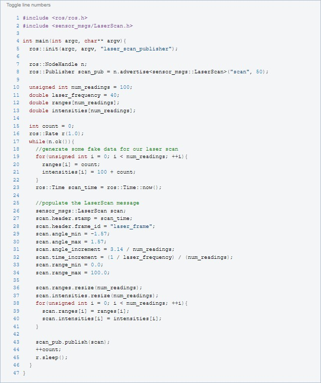
>
> _c, Odometry Information (Thông tin đo đường: vận tốc, gia tốc, chiều quay…)_
>
> Thông báo nav_msgs/Odometry qua ROS có chứa ước tính về vị trí và vận tốc của robot trong không gian:
>
> 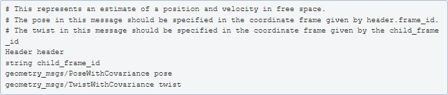
>
> Pose trong thông báo này tương ứng với vị trí ước tính của rô-bốt trong khung đo đường cùng với một hiệp phương sai tùy chọn để đảm bảo tính chắc chắn của ước tính tư thế đó. Twist trong thông báo này tương ứng với vận tốc của rô-bốt, thường là khung tọa độ của đế di động, cùng với một phương sai tùy chọn để đảm bảo chắc chắn cho ước tính vận tốc đó.
>
> Viết code:
>
> Thêm phần dependancy vào manifest.xml gói của bạn:

> 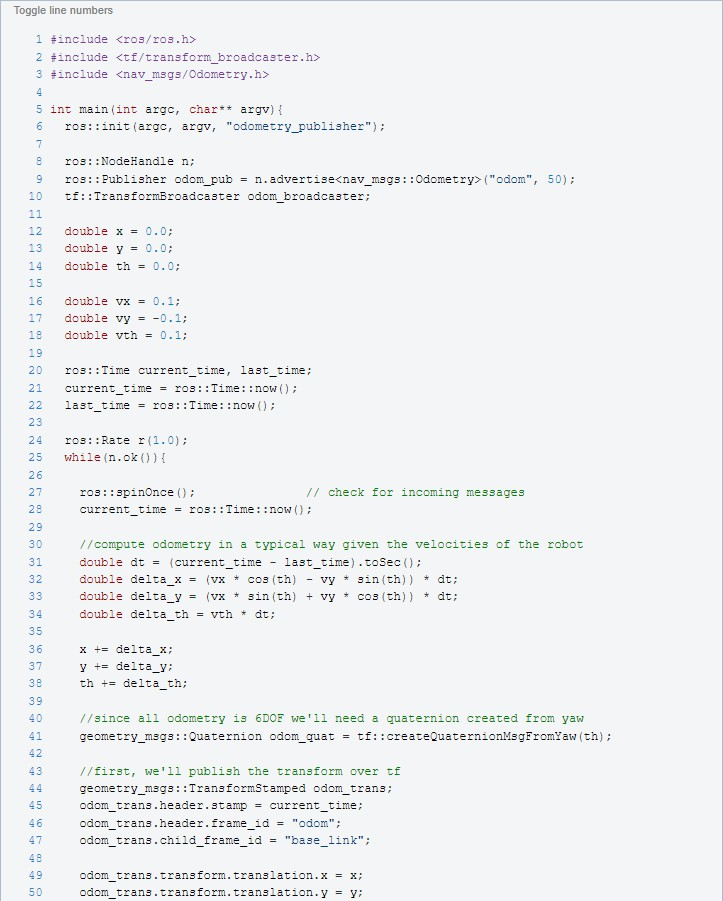
>
> 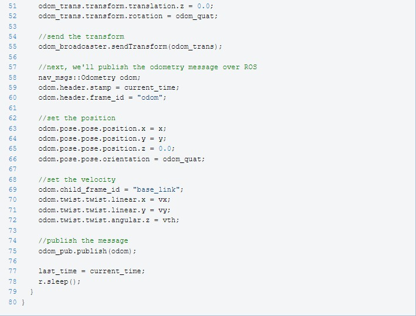
>
> _d, Base Controller (bộ điều khiển cơ sở)_
>
> Ngăn xếp điều hướng giả định rằng nó có thể gửi các lệnh vận tốc bằng cách sử dụng thông báo geometry_msgs/Twist được giả định là nằm trong khung tọa độ cơ sở của rô-bốt theo chủ đề "cmd_vel". Điều này có nghĩa là phải có một nút đăng ký chủ đề "cmd_vel" có khả năng lấy (vx, vy, vtheta) \<==\> (cmd_vel.linear.x, cmd_vel.linear.y, cmd_vel.angular.z) vận tốc và chuyển đổi chúng thành lệnh vận động để gửi đến cơ sở di động.
>
> _e, Mapping ( Map_server )_
>
> Navigation stack yêu cầu phải có một bản đồ để có thể hoạt động.

# CHƯƠNG 4: KẾT LUẬN VÀ ĐỊNH HƯỚNG PHÁT TRIỂN

## Kết quả đạt được

1.  **Lý thuyết**
    - Thiết kế mô hình và lựa chọn cơ cấu hợp lý.

    - Tính toán bài toán động học, động lực học cho Robot di động.

    - Tính toán được bài toán phục vụ lễ tân.

    - Cách kết nối Lidar với Raspberry pi và liên kết Raspberry pi với HostComputer.

    - Truyền được dữ liệu góc và tốc độ từ IMU và Encoder lên Raspi và truyền ngược lại vận tốc về 2 bánh về STM32.

2.  **Thực nghiệm**
    - Lập được bản đồ phòng lễ tân.

    - Thiết kế thành công mô hình robot phục vụ lễ tân.

    - Đảm bảo an toàn sử dụng.

    - Đạt được mục tiêu đề ra.

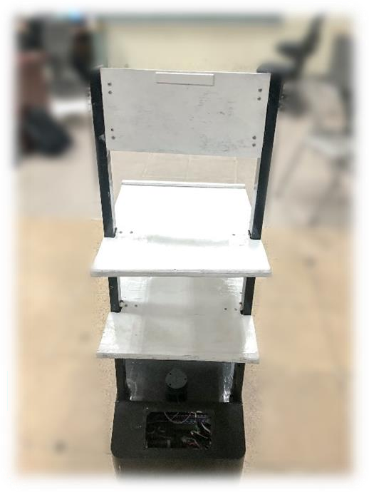

_Hình 4.1: Mô hình thực tế_

> ∗ **Kết quả bản đồ thực tế thu được nhờ cảm biến Lidar:**

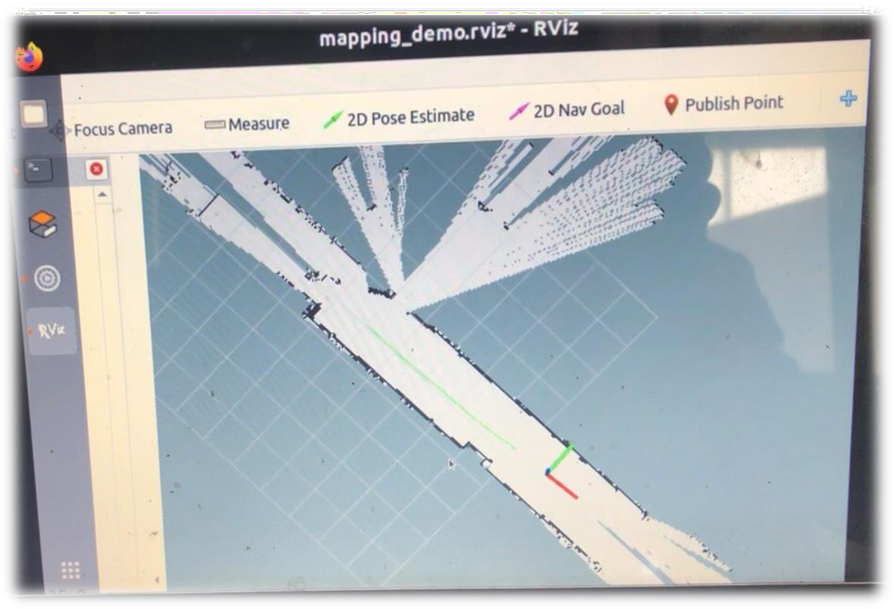

> _Hình 4.2: Bản đồ quét được trên không gian thực tế_

3.  **Hạn chế**

> Do kiến thức và thời gian nghiên cứu phát triển hạn chế nên robot vẫn gặp một vài hạn chế sau:

- Kết cấu, hình dạng Robot chưa thực sự đạt tính thẩm mỹ, robot còn thô sở và chưa được cứng cáp.

- Hệ thống di chuyển chưa ổn định.

- Robot hoạt động chưa thật sự chính xác hoàn toàn so với mặt lý thuyết.

- Vẫn còn độ trễ so với tính toán ban đầu.

- Giao diện người dùng chưa thực sự bắt mắt.

- Bản đồ quét được còn bị nhiễu, chưa rõ ràng

## Đánh giá và định hướng phát triển

- Nâng cấp thiết kế cơ khí để có thể chở được nhiều khay đồ ăn hơn, chở được nhiều sản phẩm nặng hơn.

- Thiết kế hình dáng bắt mắt cho Robot phục vụ lễ tân giúp robot có vóc dáng thân thiên với người dùng hơn.

- Thiết kế hệ thống tháo lắp pin dễ dàng hơn.

- Tích hợp thêm hệ thống IoT để khi khách đặt hàng có thể hiển thị trực tiếp trên thiết bị kết nối từ xa.

- Thêm tính năng xử lý giọng nói giúp Robot phục vụ lễ tân giao tiếp giọng nói với khách hàng.

- Chuẩn hoá các module để dễ dàng phát triển và sản xuất công nghiệp.

> Phát triển thêm về ROS, các bài toán liên quan đến định vị, điều hướng mobile robot.

# PHỤ LỤC

> **Chương trình điều khiển động cơ qua Encoder:**
>
> /\* USER CODE BEGIN Header \*/
>
> /\*\*
>
> \*\*\*\*\*\*\*\*\*\*\*\*\*\*\*\*\*\*\*\*\*\*\*\*\*\*\*\*\*\*\*\*\*\*\*\*\*\*\*\*\*\*\*\*\*\*\*\*\*\*\*\*\*\*\*\*\*\*\*\*\*\*\*\*\*\*\*\*\*
>
> \*\*\*\*\*\*\*\*\*
>
> \* @file : main.c
>
> \* @brief : Main program body
>
> \*\*\*\*\*\*\*\*\*\*\*\*\*\*\*\*\*\*\*\*\*\*\*\*\*\*\*\*\*\*\*\*\*\*\*\*\*\*\*\*\*\*\*\*\*\*\*\*\*\*\*\*\*\*\*\*\*\*\*\*\*\*\*\*\*\*\*\*\*
>
> \*\*\*\*\*\*\*\*\*
>
> \* @attention
>
> \*
>
> \* Copyright (c) 2022 STMicroelectronics.
>
> \* All rights reserved.
>
> \*
>
> \* This software is licensed under terms that can be found in the LICENSE file
>
> \* in the root directory of this software component.
>
> \* If no LICENSE file comes with this software, it is provided AS-IS.
>
> \*
>
> \*\*\*\*\*\*\*\*\*\*\*\*\*\*\*\*\*\*\*\*\*\*\*\*\*\*\*\*\*\*\*\*\*\*\*\*\*\*\*\*\*\*\*\*\*\*\*\*\*\*\*\*\*\*\*\*\*\*\*\*\*\*\*\*\*\*\*\*\*
>
> \*\*\*\*\*\*\*\*\*
>
> \*/
>
> /\* USER CODE END Header \*/
>
> /\* Includes \*/
>
> \#include "main.h"
>
> /\* Private includes \*/
>
> /\* USER CODE BEGIN Includes \*/ uint32_t time;
>
> uint8_t dulieuH; uint8_t dulieuL; int16_t angle;
>
> int16_t anglereal, anglereal1; int16_t agpre;
>
> uint8_t z = 'z'; uint8_t a = 'a'; int16_t ct = 0,
>
> ct_pre = 0,
>
> rate = 0,
>
> cm = 0;
>
> volatile float vfilt,
>
> vfilt1 ,
>
> E, E1, E2,
>
> output, lastoutput; volatile float P_part,
>
> I_part, D_part;
>
> float Ti = 0.01; float Kp = 1.2, Ki = 0.1,
>
> Kd = 0.021;
>
> unsigned int setv = 40; volatile short count = 0,
>
> count_pre=0, v = 0,
>
> vpre = 0;
>
> //===============================================
>
> unsigned int setag; volatile float agfilt,
>
> agfilt1 ,
>
> Eag, E1ag, E2ag, outputag, lastoutputag;
>
> volatile float Pag_part,
>
> Iag_part, Dag_part;
>
> float Kpag = 0.0002, Kiag = 0.001,
>
> Kdag = 0.0021;
>
> /\* USER CODE END Includes \*/
>
> /\* Private typedef \*/
>
> /\* USER CODE BEGIN PTD \*/
>
> /\* USER CODE END PTD \*/
>
> /\* Private define \*/
>
> /\* USER CODE BEGIN PD \*/
>
> /\* USER CODE END PD \*/
>
> /\* Private macro \*/
>
> /\* USER CODE BEGIN PM \*/
>
> /\* USER CODE END PM \*/
>
> /\* Private variables \*/
>
> I2C_HandleTypeDef hi2c1;
>
> TIM_HandleTypeDef htim2; TIM_HandleTypeDef htim3;
>
> UART_HandleTypeDef huart1; UART_HandleTypeDef huart2; UART_HandleTypeDef huart3;
>
> /\* USER CODE BEGIN PV \*/
>
> /\* USER CODE END PV \*/
>
> /\* Private function prototypes \*/
>
> void SystemClock_Config(void); static void MX_GPIO_Init(void);
>
> static void MX_USART1_UART_Init(void);
>
> static void MX_TIM2_Init(void); static void MX_I2C1_Init(void); static void MX_TIM3_Init(void);
>
> static void MX_USART2_UART_Init(void); static void MX_USART3_UART_Init(void);
>
> /\* USER CODE BEGIN PFP \*/
>
> //========================================= Dieu khien dong co
>
> =============================================
>
> void send_motor(uint8_t dia_chi, uint8_t chieu_quay, uint8_t toc_do)
>
> {
>
> uint8_t byte_send\[3\] = {0, 0, 0}; byte_send\[0\] = chieu_quay \<\< 7 \| dia_chi; byte_send\[1\] = toc_do;
>
> byte_send\[2\] = 255;
>
> HAL_UART_Transmit(&huart1, byte_send, 3, 1);
>
> }
>
> void Straight(uint8_t x)
>
> {
>
> send_motor(1, 1, x);
>
> send_motor(2, 1, x);
>
> }
>
> void Lui(uint8_t x)
>
> {
>
> send_motor(1, 0, x);
>
> send_motor(2, 0, x);
>
> }
>
> void Left(uint8_t x)
>
> {
>
> send_motor(1, 0, x);
>
> send_motor(2, 1, x);
>
> }
>
> void Right(uint8_t x)
>
> {
>
> send_motor(1, 1, x);
>
> send_motor(2, 0, x);
>
> }
>
> /\* USER CODE END PFP \*/
>
> /\* Private user code \*/
>
> /\* USER CODE BEGIN 0 \*/
>
> //================================== La Ban
>
> ==================================
>
> uint16_t LaBan()
>
> {
>
> HAL_UART_Transmit(&huart3, &z, 1,1);//================== bat dau gui du lieu =====================
>
> HAL_UART_Receive(&huart3, &dulieuH, 1,1);//================== nhan byte cao =====================
>
> HAL_UART_Receive(&huart3, &dulieuL, 1,1);//================== nhan byte thap =====================
>
> angle =(dulieuH\<\<8)\|dulieuL;//================== ghep thanh gia tri goc
>
> \*10 =====================
>
> HAL_Delay(10); return angle;
>
> }
>
> void Encoder()
>
> {
>
> ct = HAL_TIM_GET_COUNTER(&htim2); cm = ( fabs(ct)/500)\*37.699;
>
> }
>
> /\* USER CODE END 0 \*/
>
> int main(void)
>
> {
>
> /\* USER CODE BEGIN 1 \*/
>
> //time = HAL_GetTick();
>
> /\* USER CODE END 1 \*/
>
> /\* MCU Configuration \*/
>
> /\* Reset of all peripherals, Initializes the Flash interface and the Systick. \*/ HAL_Init();
>
> /\* USER CODE BEGIN Init \*/
>
> /\* USER CODE END Init \*/
>
> /\* Configure the system clock \*/
>
> SystemClock_Config();
>
> /\* USER CODE BEGIN SysInit \*/
>
> /\* USER CODE END SysInit \*/
>
> /\* Initialize all configured peripherals \*/ MX_GPIO_Init(); MX_USART1_UART_Init();
>
> MX_TIM2_Init(); MX_I2C1_Init(); MX_TIM3_Init(); MX_USART2_UART_Init(); MX_USART3_UART_Init();
>
> /\* USER CODE BEGIN 2 \*/
>
> HAL_TIM_Encoder_Start(&htim2, TIM_CHANNEL_1 \| TIM_CHANNEL_2);
>
> //HAL_TIM_Base_Start_IT(&htim3); HAL_Delay(200);
>
> HAL_UART_Transmit(&huart3, &a, 1,1);//================== set goc ve 0
>
> =====================
>
> HAL_Delay(1000);
>
> /\* USER CODE END 2 \*/
>
> /\* Infinite loop \*/
>
> /\* USER CODE BEGIN WHILE \*/
>
> while (1)
>
> {
>
> anglereal = LaBan();
>
> if(anglereal\<900)
>
> {
>
> Left(7);
>
> }
>
> else Straight(7);
>
> /\* USER CODE END WHILE \*/
>
> /\* USER CODE BEGIN 3 \*/
>
> }
>
> /\* USER CODE END 3 \*/
>
> }
>
> /\*\*
>
> \* @brief System Clock Configuration
>
> \* @retval None
>
> \*/
>
> void SystemClock_Config(void)
>
> {
>
> RCC_OscInitTypeDef RCC_OscInitStruct = {0}; RCC_ClkInitTypeDef RCC_ClkInitStruct = {0};
>
> /\*\* Initializes the RCC Oscillators according to the specified parameters
>
> \* in the RCC_OscInitTypeDef structure.
>
> \*/
>
> RCC_OscInitStruct.OscillatorType = RCC_OSCILLATORTYPE_HSE; RCC_OscInitStruct.HSEState = RCC_HSE_ON; RCC_OscInitStruct.HSEPredivValue = RCC_HSE_PREDIV_DIV1; RCC_OscInitStruct.HSIState = RCC_HSI_ON; RCC_OscInitStruct.PLL.PLLState = RCC_PLL_ON; RCC_OscInitStruct.PLL.PLLSource = RCC_PLLSOURCE_HSE; RCC_OscInitStruct.PLL.PLLMUL = RCC_PLL_MUL9;
>
> if (HAL_RCC_OscConfig(&RCC_OscInitStruct) != HAL_OK)
>
> {
>
> Error_Handler();
>
> }
>
> /\*\* Initializes the CPU, AHB and APB buses clocks
>
> \*/
>
> RCC_ClkInitStruct.ClockType =
>
> RCC_CLOCKTYPE_HCLK\|RCC_CLOCKTYPE_SYSCLK
>
> \|RCC_CLOCKTYPE_PCLK1\|RCC_CLOCKTYPE_PCLK2;
>
> RCC_ClkInitStruct.SYSCLKSource = RCC_SYSCLKSOURCE_PLLCLK; RCC_ClkInitStruct.AHBCLKDivider = RCC_SYSCLK_DIV1; RCC_ClkInitStruct.APB1CLKDivider = RCC_HCLK_DIV2; RCC_ClkInitStruct.APB2CLKDivider = RCC_HCLK_DIV1;
>
> if (HAL_RCC_ClockConfig(&RCC_ClkInitStruct, FLASH_LATENCY_2) != HAL_OK)
>
> {
>
> Error_Handler();
>
> }
>
> }
>
> /\*\*
>
> \* @brief I2C1 Initialization Function
>
> \* @param None
>
> \* @retval None
>
> \*/
>
> /\* USER CODE BEGIN TIM3_Init 1 \*/
>
> /\* USER CODE END TIM3_Init 1 \*/ htim3.Instance = TIM3; htim3.Init.Prescaler = 7199;
>
> htim3.Init.CounterMode = TIM_COUNTERMODE_UP; htim3.Init.Period = 99;
>
> htim3.Init.ClockDivision = TIM_CLOCKDIVISION_DIV1; htim3.Init.AutoReloadPreload = TIM_AUTORELOAD_PRELOAD_DISABLE; if (HAL_TIM_Base_Init(&htim3) != HAL_OK)
>
> {
>
> Error_Handler();
>
> }
>
> sClockSourceConfig.ClockSource = TIM_CLOCKSOURCE_INTERNAL;
>
> if (HAL_TIM_ConfigClockSource(&htim3, &sClockSourceConfig) != HAL_OK)
>
> {
>
> Error_Handler();
>
> }
>
> sMasterConfig.MasterOutputTrigger = TIM_TRGO_RESET; sMasterConfig.MasterSlaveMode = TIM_MASTERSLAVEMODE_DISABLE;
>
> if (HAL_TIMEx_MasterConfigSynchronization(&htim3, &sMasterConfig) != HAL_OK)
>
> {
>
> Error_Handler();
>
> }
>
> /\* USER CODE BEGIN TIM3_Init 2 \*/
>
> /\* USER CODE END TIM3_Init 2 \*/
>
> }
>
> /\*\*
>
> \* @brief USART1 Initialization Function
>
> \* @param None
>
> \* @retval None
>
> \*/
>
> static void MX_USART1_UART_Init(void)
>
> {
>
> /\* USER CODE BEGIN USART1_Init 0 \*/
>
> /\* USER CODE END USART1_Init 0 \*/
>
> /\* USER CODE BEGIN USART1_Init 1 \*/
>
> /\* USER CODE END USART1_Init 1 \*/
>
> huart1.Instance = USART1; huart1.Init.BaudRate = 115200;
>
> huart1.Init.WordLength = UART_WORDLENGTH_8B; huart1.Init.StopBits = UART_STOPBITS_1; huart1.Init.Parity = UART_PARITY_NONE; huart1.Init.Mode = UART_MODE_TX_RX; huart1.Init.HwFlowCtl = UART_HWCONTROL_NONE; huart1.Init.OverSampling = UART_OVERSAMPLING_16; if (HAL_UART_Init(&huart1) != HAL_OK)
>
> {
>
> Error_Handler();
>
> }
>
> /\* USER CODE BEGIN USART1_Init 2 \*/
>
> /\* USER CODE END USART1_Init 2 \*/
>
> }
>
> /\*\*
>
> \* @brief USART2 Initialization Function
>
> \* @param None
>
> \* @retval None
>
> \*/
>
> static void MX_USART2_UART_Init(void)
>
> {
>
> /\* USER CODE BEGIN USART2_Init 0 \*/
>
> /\* USER CODE END USART2_Init 0 \*/
>
> /\* USER CODE BEGIN USART2_Init 1 \*/
>
> /\* USER CODE END USART2_Init 1 \*/
>
> huart2.Instance = USART2; huart2.Init.BaudRate = 115200;
>
> huart2.Init.WordLength = UART_WORDLENGTH_8B; huart2.Init.StopBits = UART_STOPBITS_1; huart2.Init.Parity = UART_PARITY_NONE; huart2.Init.Mode = UART_MODE_TX_RX; huart2.Init.HwFlowCtl = UART_HWCONTROL_NONE; huart2.Init.OverSampling = UART_OVERSAMPLING_16; if (HAL_UART_Init(&huart2) != HAL_OK)
>
> {
>
> Error_Handler();
>
> }
>
> /\* USER CODE BEGIN USART2_Init 2 \*/
>
> /\* USER CODE END USART2_Init 2 \*/
>
> }
>
> /\*\*
>
> \* @brief USART3 Initialization Function
>
> \* @param None
>
> \* @retval None
>
> \*/
>
> static void MX_USART3_UART_Init(void)
>
> {
>
> /\* USER CODE BEGIN USART3_Init 0 \*/
>
> /\* USER CODE END USART3_Init 0 \*/
>
> /\* USER CODE BEGIN USART3_Init 1 \*/
>
> /\* USER CODE END USART3_Init 1 \*/
>
> huart3.Instance = USART3; huart3.Init.BaudRate = 115200;
>
> huart3.Init.WordLength = UART_WORDLENGTH_8B; huart3.Init.StopBits = UART_STOPBITS_1; huart3.Init.Parity = UART_PARITY_NONE; huart3.Init.Mode = UART_MODE_TX_RX; huart3.Init.HwFlowCtl = UART_HWCONTROL_NONE; huart3.Init.OverSampling = UART_OVERSAMPLING_16; if (HAL_UART_Init(&huart3) != HAL_OK)
>
> {
>
> Error_Handler();
>
> }
>
> /\* USER CODE BEGIN USART3_Init 2 \*/
>
> /\* USER CODE END USART3_Init 2 \*/
>
> }
>
> /\*\*
>
> \* @brief GPIO Initialization Function
>
> \* @param None
>
> \* @retval None
>
> \*/
>
> static void MX_GPIO_Init(void)
>
> {
>
> /\* GPIO Ports Clock Enable \*/
>
> HAL_RCC_GPIOD_CLK_ENABLE();
>
> HAL_RCC_GPIOA_CLK_ENABLE();
>
> HAL_RCC_GPIOB_CLK_ENABLE();
>
> }
>
> /\* USER CODE BEGIN 4 \*/
>
> /\* USER CODE END 4 \*/
>
> /\*\*
>
> \* @brief This function is executed in case of error occurrence.
>
> \* @retval None
>
> \*/
>
> void Error_Handler(void)
>
> {
>
> /\* USER CODE BEGIN Error_Handler_Debug \*/
>
> /\* User can add his own implementation to report the HAL error return state \*/
>
> disable_irq(); while (1)
>
> {
>
> }
>
> /\* USER CODE END Error_Handler_Debug \*/
>
> }
>
> void assert_failed(uint8_t \*file, uint32_t line)
>
> {
>
> /\* USER CODE BEGIN 6 \*/
>
> /\* User can add his own implementation to report the file name and line number, ex: printf("Wrong parameters value: file %s on line %d\r\n", file, line) \*/
>
> /\* USER CODE END 6 \*/
>
> }
>
> \#endif /\* USE_FULL_ASSERT \*/

# TÀI LIỆU THAM KHẢO

1.  PGS. TS. Trịnh Chất – TS. Lê Văn Uyển, Tính toán thiết kế hệ thống dẫn động cơ khí, Nhà xuất bản Giáo Dục, 2007.

2.  Lê Ngọc Duy, Giáo trình Cảm biến và hệ thống đo, Đại học Công nghiệp Hà Nội, 2019.

3.  Spyros G. Tzafestas, Introduction to Mobile Robot Control

4.  Prof. Alessandro De Luca, Wheel Mobile Robots Introduction anh Kinematic Modeling.

5.  Ronal Siegward - Illah Reza Nourbakhsh - Davide Scaramuzza, Introduction to Autonomous Mobile Robots.

6.  Gang Peng (2018), _“An Improved AMCL Algorithm Based on Laser Scanning Match in a Complex and Unstructured Environment”_, pp. 1-4.

7.  D. F. D. F. Global planner, _"The Dynamic Window Approach to Collision Avoidance",_ pp. 10-12.

8.  Viktor Kozák (2013), _“Local planning for a mobile robot”_, Czech Technical University In Prague.

9.  R. N. Wiki, "Robot Operating System Wiki," Navigation, \[Online\]. Available: [<u>http://wiki.ros.org/navigation/Tutorials/RobotSetup</u>.](http://wiki.ros.org/navigation/Tutorials/RobotSetup)

10. W. C. ROS, "Robot Operating System Wiki," Costmap 2D, \[Online\]. Available: [<u>http://wiki.ros.org/costmap_2d.s</u>.](http://wiki.ros.org/costmap_2d.s)

11. M. Seder, K. Maˇcek, I. Petroviˇc, _“An integrated approach to real-time mobile robot control in partially known indoor environments”,_ Industrial Electronics Society, 2005. IECON 2005.

12. A. Koubaa (2018), _“Introduction to Mobile Robot Path Planning”_, Springer International Publishing AG.

13. YoonSeok Pyo \| HanCheol Cho \| RyuWoon Jung \| TaeHoon Lim (2017), _“ROS Robot Programming”_, ROBOTIS Co.,Ltd.

14. Francisco Valero, Carlos Llopis-Albert, Carlos Llopis-Albert (2019), _“A review of mobile robots: Concepts, methods, theoretical framework, and applications”._

15. J. Minguez and L. Montano, Nearness diagram (ND), _“Collision avoidance in troublesome scenarios”._ IEEE Transactions on Robotics and Automation, 2004.

16. Thaker Nayl, Mohammed Q Mohammed, and Saif Q Muhamed. 2017. _“Obstacles avoidance for an articulated robot using modified smooth path planning”._ 2017 international conference on computer and applications (ICCA), IEEE.

17. J. Borenstein and Y. Koren, _“The Vector Field Histogram-Fast Obstacle Avoidance for Mobile Robots”._ IEEE TRANSACTIONS ON ROBOTICS AND AUTOMATION, 1991.
